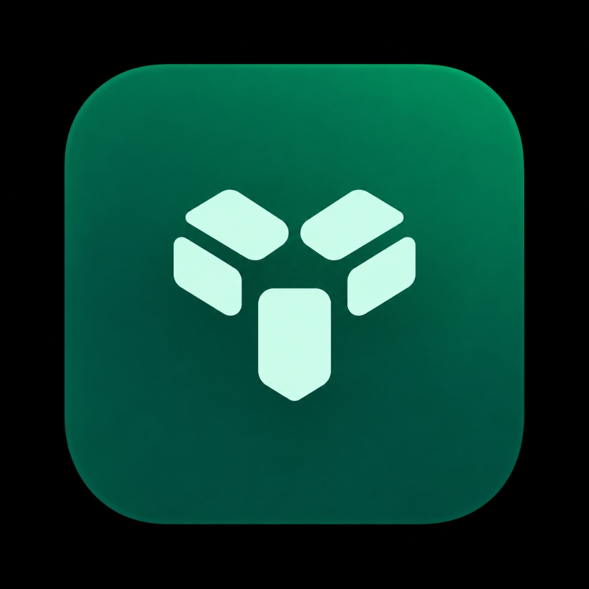
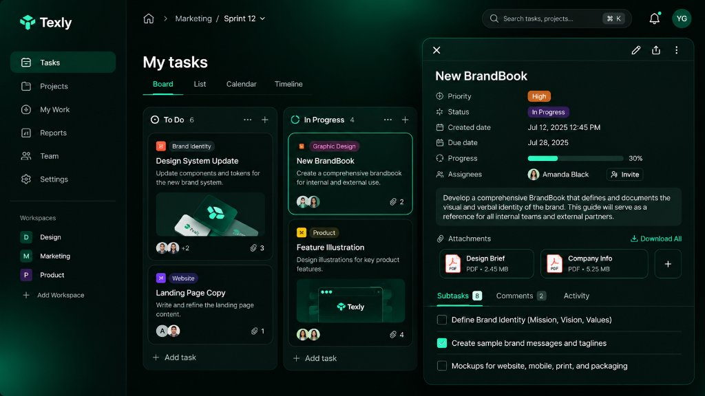
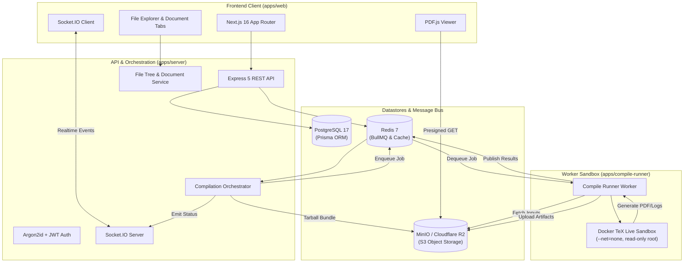

<div align="center">
  
  <h1>Texly</h1>
  <p><strong>Modern, High-Performance, Sandboxed LaTeX Authoring Platform</strong></p>

[](#development-status)
[](#getting-started)
[](#getting-started)
[](#tech-stack)
[](#project-structure)

  <br />

  <p align="center">
    Texly is a next-generation LaTeX editor and document workspace designed for researchers, engineers, and academics. It combines an isolated containerized compilation pipeline, realtime diagnostics, integrated PDF.js preview, and a refined Dark Emerald aesthetic.
  </p>
</div>

---

> [!IMPORTANT]
> **Active Development Status**: Texly is currently in active development. Core infrastructure, authentication, containerized compilation, realtime diagnostics, PDF preview, and file/document management are implemented and verified. Advanced CodeMirror editing extensions, version history, and collaborative AI workflows are in progress.

---

## Visual Showcase

<div align="center">
  
  <p><em>Texly Dark Emerald workspace featuring responsive navigation, task and project management, and high-contrast typography.</em></p>
</div>

---

## Key Features

### Implemented & Verified Capabilities

- **Isolated LaTeX Compilation Pipeline (`apps/compile-runner`, `docker/texlive`)**:
  - Secure compilation in ephemeral Alpine TeX Live Docker containers with network disabled (`--net=none`), read-only root filesystems, dropped capabilities (`--cap-drop=ALL`), and non-root execution (`texuser:10001`).
  - Supports `pdfLaTeX`, `XeLaTeX`, and `LuaLaTeX` engines with a strict 30-second execution deadline.
  - Automatic `inputHash` generation (SHA-256) delivering instant cache-hit responses (`201 SUCCEEDED`).
  - Latest-wins queue coalescing to supersede stale compilations and prevent queue congestion.
  - S3 / MinIO presigned URL artifact ingestion (PDF, compile logs, SyncTeX).
  - Background self-healing reconciliation sweep (`reconcileStaleCompilations`) to recover orphaned jobs.

- **Realtime Compilation Status & Diagnostics (`apps/web`, `apps/server`)**:
  - WebSocket lifecycle updates via Socket.IO (`QUEUED`, `RUNNING`, `SUCCEEDED`, `FAILED`, `TIMED_OUT`, `CANCELLED`).
  - Interactive compile toolbar with keyboard shortcut (`Cmd/Ctrl + Enter`) and status chip.
  - Realtime problems drawer parsing LaTeX errors, warnings, and missing packages with direct jump-to-line navigation.
  - Raw compile log inspection modal with search, copy, and export capabilities.
  - Intelligent auto-compilation debounced on document save.

- **High-Performance PDF.js Preview (`apps/web`)**:
  - Client-side rendering with canvas and high-DPI scaling (`window.devicePixelRatio`).
  - Dedicated text selection layer for copying formulas and text directly from the preview.
  - Continuous virtualized page scrolling optimized for high page counts.
  - Controls: zoom in/out, fit-to-width, fit-to-page, arbitrary zoom (50%–300%), rotation, page jumping, download, and fullscreen.
  - Viewing position retention: preserves scroll location, zoom level, and active page across recompilations without visual flicker.

- **Project File Explorer & Document Management (`apps/web`, `apps/server`)**:
  - Hierarchical tree explorer supporting nested directories up to 12 levels deep.
  - Materialized path management with atomic descendant path cascading on folder move/rename.
  - In-place creation and inline rename with keyboard support (`Enter` / `Escape`) and extension validation.
  - HTML5 drag-and-drop reorganization with circular move prevention and auto-expansion.
  - Designation of main compilation document with `main` badge and automatic cascade protection.
  - Soft-deletion confirmation modal with subtree deletion warnings.
  - Tabbed document state via Zustand (`editor.store.ts`) with dirty indicators, middle-click closure, unsaved change warnings, and view-state caching (cursor, scroll position, local draft).

- **Enterprise Security & Multi-Tenant Workspaces (`apps/server`)**:
  - Argon2id password hashing with HaveIBeenPwned k-anonymity breach detection.
  - Asymmetric JWT access tokens (RS256) with key rotation (`kid`) and opaque HTTP-only sliding refresh tokens with automatic reuse detection.
  - Personal and shared workspace isolation with role-based access control (`OWNER`, `ADMIN`, `EDITOR`, `VIEWER`).
  - Starter templates (Article, Report, Book, Letter, Resume, Presentation).
  - Redis sliding-window rate limiters on all authentication endpoints.

- **Texly Dark Emerald Theme**:
  - Modern, minimal SaaS aesthetic with deep black (`#050807`), dark emerald (`#003D30`), and mint accents (`#00D69A`).
  - Fully responsive mobile-first layouts across phone, tablet, laptop, and desktop viewports.

---

### Upcoming & Planned Features

- **CodeMirror 6 LaTeX IDE Extensions**: Custom syntax folding, bracket matching, package-aware autocompletion, and visual outline navigation.
- **Version History & Snapshot Restore**: Periodic checkpoints and manual snapshots with diff comparison and rollback protection.
- **Collaborative AI Proposals**: Context-aware LaTeX writing assistance, automated bibtex formatting, and proposal acceptance workflows.
- **Realtime Collaboration**: Multi-user concurrent document editing backed by conflict-free replicated data types.

---

## System Architecture



---

## Tech Stack

| Domain                     | Technology                                                                                    | Role                                              |
| :------------------------- | :-------------------------------------------------------------------------------------------- | :------------------------------------------------ |
| **Frontend**               | [Next.js 16](https://nextjs.org/) (App Router), [React 19](https://react.dev/)                | Application framework & UI shell                  |
|                            | [Tailwind CSS](https://tailwindcss.com/), [shadcn/ui](https://ui.shadcn.com/)                 | Dark Emerald design system & UI components        |
|                            | [TanStack Query v5](https://tanstack.com/query)                                               | Server state management & cache invalidation      |
|                            | [Zustand](https://zustand-demo.pmnd.rs/)                                                      | Editor client state, document tabs, view caching  |
|                            | [PDF.js](https://mozilla.github.io/pdf.js/)                                                   | High-DPI canvas & text layer PDF rendering        |
|                            | [Socket.IO Client](https://socket.io/)                                                        | Realtime compilation & file synchronization       |
| **Backend**                | [Express 5](https://expressjs.com/), [Node.js 24](https://nodejs.org/)                        | Core API server & business logic                  |
|                            | [TypeScript 5.9](https://www.typescriptlang.org/)                                             | Strict static typing across monorepo              |
|                            | [Prisma 7](https://www.prisma.io/)                                                            | Object-relational mapping & schema migrations     |
|                            | [PostgreSQL 17](https://www.postgresql.org/)                                                  | Relational database with partial unique indexes   |
|                            | [BullMQ](https://bullmq.io/) & [Redis 7](https://redis.io/)                                   | Job queues, rate limiting, and cache invalidation |
|                            | [Pino](https://getpino.io/)                                                                   | High-performance structured logging               |
| **Compiler & Sandbox**     | [TeX Live](https://www.tug.org/texlive/)                                                      | `pdfLaTeX`, `XeLaTeX`, `LuaLaTeX` engines         |
|                            | [Dockerode](https://github.com/apocas/dockerode)                                              | Programmatic ephemeral container orchestration    |
|                            | [Alpine Linux Container](https://alpinelinux.org/)                                            | Hardened non-root sandbox execution image         |
| **Storage & Object Store** | [MinIO](https://min.io/) / [Cloudflare R2](https://www.cloudflare.com/developer-platform/r2/) | S3-compatible snapshot & artifact storage         |
| **DevOps & Tooling**       | [Turborepo](https://turbo.build/repo), [pnpm](https://pnpm.io/)                               | Monorepo orchestration & package management       |
|                            | [Vitest](https://vitest.dev/)                                                                 | Unit, component, and integration test runner      |
|                            | [Zod](https://zod.dev/)                                                                       | Runtime contract validation & DTO schemas         |

---

## Project Structure

```
texly/
├── apps/
│   ├── compile-runner/       # Isolated BullMQ compilation worker & Docker orchestrator
│   ├── server/               # Express API: auth, projects, files, compilations, realtime
│   └── web/                  # Next.js 16 frontend: editor, file explorer, PDF preview, auth
├── docker/
│   ├── compose.dev.yml       # Local dev services: Postgres, Redis, MinIO, Mailpit
│   └── texlive/              # Hardened Alpine TeX Live sandbox Dockerfile & verification
├── docs/
│   ├── assets/               # Logos, visual references, and screenshots
│   ├── phase_progress/       # Comprehensive phase completion reports (Phases 00–06D)
│   ├── API_SPECIFICATION.md  # Detailed REST & WebSocket API specification
│   ├── COMPILATION_ENGINE.md # Sandbox security constraints and compiler lifecycle
│   ├── DATABASE_DESIGN.md    # Database schema, relations, and index strategies
│   ├── SYSTEM_ARCHITECTURE.md# System overview, failure modes, and boundaries
│   └── openapi.json          # Generated OpenAPI 3.1 contract specification
├── packages/
│   ├── config/               # Shared ESLint, Prettier, and TypeScript configurations
│   ├── db/                   # Prisma schema, migrations, and database seeders
│   └── shared/               # Shared domain Zod schemas, DTOs, and OpenAPI generator
├── .dependency-cruiser.cjs   # Strict package boundary enforcement rules
├── package.json              # Root workspace scripts & dev dependencies
├── pnpm-workspace.yaml       # pnpm workspace definition
└── turbo.json                # Turborepo task pipelines
```

---

## Getting Started

### Prerequisites

Ensure you have the following installed locally:

- **Node.js**: `>= 24.0.0`
- **pnpm**: `>= 10.0.0` (`corepack enable pnpm`)
- **Docker & Docker Compose**: Required for running the database, Redis, MinIO, and compilation sandbox.

### 1. Clone the Repository

```bash
git clone https://github.com/your-username/texly.git
cd texly
```

### 2. Install Dependencies

```bash
pnpm install
```

### 3. Configure Environment Variables

Create `.env` files for the server, web, and compilation runner by copying the provided examples:

```bash
cp apps/server/.env.example apps/server/.env
cp apps/web/.env.example apps/web/.env
cp apps/compile-runner/.env.example apps/compile-runner/.env
```

### 4. Start Local Infrastructure

Start PostgreSQL, Redis, MinIO, and Mailpit via Docker Compose:

```bash
docker compose -f docker/compose.dev.yml up -d
```

### 5. Build TeX Live Sandbox Image

Build the isolated compilation container image:

```bash
docker build -t texlive-sandbox:latest docker/texlive
```

### 6. Initialize Database & Seed Starter Templates

Run Prisma migrations and seed the initial templates:

```bash
pnpm --filter @texly/db prisma migrate dev
pnpm --filter @texly/db prisma db seed
```

### 7. Run the Development Environment

Start all applications and services concurrently:

```bash
pnpm dev
```

The application will be accessible at:

- **Web Application**: [http://localhost:3000](http://localhost:3000)
- **API Server**: [http://localhost:4000](http://localhost:4000)
- **MinIO Console**: [http://localhost:9001](http://localhost:9001) (`minioadmin` / `minioadmin_secret`)
- **Mailpit SMTP Webmail**: [http://localhost:8025](http://localhost:8025)

---

## Testing & Quality Assurance

Texly maintains strict test suites across all packages.

```bash
# Run all unit and integration tests across web and server
pnpm test

# Run strict TypeScript typecheck across all workspaces
pnpm typecheck

# Verify architectural import boundaries
pnpm check:boundaries

# Regenerate OpenAPI contracts from Zod schemas
pnpm gen:openapi
```

---

## Development Status & Roadmap

Texly's implementation follows the structured milestones documented in [`docs/IMPLEMENTATION_ROADMAP.md`](docs/IMPLEMENTATION_ROADMAP.md). Detailed phase completion reports are available in [`docs/phase_progress/`](docs/phase_progress/):

| Milestone       | Scope                                        |     Status     | Phase Report                                                 |
| :-------------- | :------------------------------------------- | :------------: | :----------------------------------------------------------- |
| **Phase 00**    | Monorepo, Infrastructure, Contracts & CI     |  ✅ Completed  | [Report](docs/phase_progress/PHASE_00_COMPLETION_REPORT.md)  |
| **Phase 01**    | Authentication, Workspaces, RBAC & Dashboard |  ✅ Completed  | [Report](docs/phase_progress/PHASE_01_COMPLETION_REPORT.md)  |
| **Phase 05**    | LaTeX Compilation Engine & Sandbox Runner    |  ✅ Completed  | [Report](docs/phase_progress/PHASE_05_COMPLETION_REPORT.md)  |
| **Phase 06A**   | PDF.js Viewer & High-DPI Preview Integration |  ✅ Completed  | [Report](docs/phase_progress/PHASE_06A_COMPLETION_REPORT.md) |
| **Phase 06B**   | Realtime Compilation Status & Diagnostics    |  ✅ Completed  | [Report](docs/phase_progress/PHASE_06B_COMPLETION_REPORT.md) |
| **Phase 06C**   | Backend File System & Document Persistence   |  ✅ Completed  | [Report](docs/phase_progress/PHASE_06C_COMPLETION_REPORT.md) |
| **Phase 06D**   | Frontend File Explorer & Document Management |  ✅ Completed  | [Report](docs/phase_progress/PHASE_06D_COMPLETION_REPORT.md) |
| **Phase 03**    | CodeMirror LaTeX Editor & Outline Panel      | 🟡 In Progress | _Under active development_                                   |
| **Phase 07**    | Version History & Snapshot Comparison        |   ⚪ Planned   | _Roadmap_                                                    |
| **Phase 08/09** | AI LaTeX Proposals & Approval Engine         |   ⚪ Planned   | _Roadmap_                                                    |
| **Phase 10/11** | Realtime Collaboration & Hardening           |   ⚪ Planned   | _Roadmap_                                                    |

---

## Contributing & Development Guidelines

1. **Strict Types**: No `any` or loose type assertions. All APIs must validate input and output using Zod schemas from `@texly/shared`.
2. **Boundary Enforcement**: Cross-package imports must conform to `.dependency-cruiser.cjs`. Workers must never directly access the database.
3. **Transactional Integrity**: All multi-entity database operations must use Prisma transactions.
4. **Testing Requirement**: Every bug fix, feature, and API route must be accompanied by integration and component tests.

---

## License

This project is licensed under the [MIT License](LICENSE) (or applicable workspace license).
