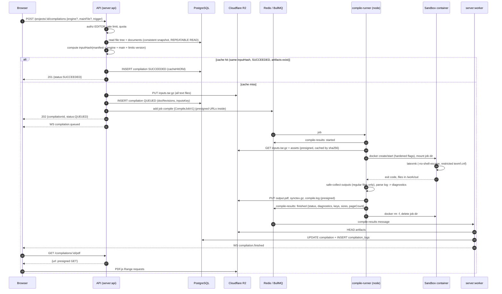

# COMPILATION_ENGINE.md

LaTeX compilation is **execution of untrusted, user-controlled input**. The design therefore separates (1) orchestration (API/worker, trusted, has secrets) from (2) execution (compile runner + per-job sandbox container, untrusted workload, no secrets).

---

## 1. Overview



## 2. Compilation requests (how they start)

Triggers: **manual** (Compile button or `Mod-Enter`), **auto** (project setting; debounce 3 s after a successful autosave; never while a review-mode proposal is pending on the active file), **post-accept** (user prompt after AI accept), **restore**.

`POST /projects/:projectId/compilations` body: `{ trigger, engine?, bibTool?, mainFile? , draft?: boolean }` (defaults from project settings). The service:

1. AuthZ `EDITOR`; plan limits (concurrent per user = 1, per-10-minute count, monthly compile seconds).
2. **Coalescing (latest-wins):** if a compilation for the project is `QUEUED`, mark it `SUPERSEDED` and replace it. If one is `RUNNING`, queue the new one behind it (max 1 queued). Superseded jobs are removed from BullMQ if not yet active.
3. Takes a **consistent snapshot** (single `REPEATABLE READ` transaction) of the project's live file tree and text documents; records `docRevisions`. *Compile always uses saved server state*: the client flushes autosave first (`Compile` = save-then-compile).
4. Validates the manifest: main file exists and is `.tex`; total size ≤ limits; file count ≤ limits; every path normalized (no `..`, no absolute, no leading `-`, no backslash, no control chars), no duplicates differing only by case.
5. Cache check (§10), then creates the DB row **before** enqueueing (so a crash cannot lose the request); enqueue failure → row `FAILED(INFRA)` and `503`.

## 3. BullMQ design

| Queue | Producer → Consumer | Purpose |
|---|---|---|
| `compile` | `server:api` → `compile-runner` | One job per compilation. `jobId = compilationId` (idempotent add). |
| `compile-results` | `compile-runner` → `server:worker` | Durable result/status messages (`started`, `finished`). Idempotent handlers keyed by `compilationId`+`type`. |
| `compile-maintenance` | `server:worker` (repeatable) | Reconciler, artifact retention, orphan container sweeps trigger. |

`compile` job options: `attempts: 2` (retry **only** infrastructure failures such as node loss/stall, never user errors/timeouts), `backoff: exponential 2 s`, `removeOnComplete: {age: 3600}`, `removeOnFail: {age: 86400}`, `priority` by plan (paid higher), `lockDuration` > max compile time + slack with auto-renew, `stalledInterval` default.
Runner concurrency = `floor(vCPU / cpusPerJob)` per node (e.g., 4 vCPU node, 1 CPU/job → 3 concurrent, leaving a core for the OS/runner).
**Fairness:** BullMQ groups are a Pro feature; instead the API enforces per-user concurrency 1 and per-project latest-wins, and queue priority separates plans.

**Reconciler (every 30 s):** (a) `QUEUED` rows older than 30 s with no BullMQ job → re-enqueue; (b) `RUNNING` rows older than `timeout + 60 s` with no active job → mark `FAILED(INFRA)`; (c) completed jobs whose result message was never ingested (Redis result queue loss) → mark failed with retry hint.

### CompileJobV1 (contract in `packages/shared`)
```jsonc
{
  "version": 1,
  "compilationId": "uuid", "projectId": "uuid",
  "engine": "pdflatex|xelatex|lualatex", "bibTool": "auto|bibtex|biber|none",
  "mainFile": "main.tex",
  "draft": false,
  "limits": { "timeoutSec": 60, "memoryMb": 1024, "cpus": 1, "pidsLimit": 256,
              "maxPdfMb": 50, "maxLogMb": 5, "maxOutputFiles": 200, "workDirMb": 512 },
  "inputs": {
    "textBundle": { "url": "<presigned GET>", "sha256": "…", "sizeBytes": 12345 },
    "assets": [ { "path": "figs/a.png", "url": "<presigned GET>", "sha256": "…", "sizeBytes": 102400 } ]
  },
  "outputs": {
    "pdf":     { "url": "<presigned PUT>" },
    "synctex": { "url": "<presigned PUT>" },
    "log":     { "url": "<presigned PUT>" }
  },
  "expiresAt": "ISO-8601"
}
```
The runner refuses jobs past `expiresAt`, with `sizeBytes` over limits, or with schema mismatch.

## 4. Docker sandbox (per job)

### 4.1 Image (`texly/texlive:<TL-year>`)
- Base: Debian/Ubuntu slim + **TeX Live installed from the official `install-tl` with a pinned release** (profile: `scheme-full` for MVP, i.e., no user-facing "missing package" tickets; optimize later), plus `latexmk`, `biber`, `bibtex` (part of TeX Live), `synctex`, `ghostscript`, `fontconfig` with a curated font set, `qpdf` (page count/linearize), `inkscape` **not** included.
- **No `tlmgr` network access at runtime**; `tlmgr` removed or non-executable for the sandbox user. Package updates = new image build (tested in CI, rolled by tag).
- Non-root user `texly` (uid/gid 10001). No shells beyond `sh`/`bash` needed by latexmk; no compilers, `curl`, `wget`, `git`, `ssh`, `python` (reduces post-exploit tooling; `latexmk` needs Perl — keep Perl, drop others).
- Custom `texmf.cnf` at `/opt/texly/texmf.cnf` (§4.3), read-only.
- Image scanned by Trivy in CI; rebuilt weekly for base-image patches.

### 4.2 `docker run` equivalent (created via `dockerode`, flags are code-enforced, never user-influenced)

```
--network none
--read-only                                  # root FS read-only
--cap-drop ALL
--security-opt no-new-privileges
--security-opt seccomp=<texly-seccomp.json>  # default Docker profile as baseline; tightened later
--pids-limit 256
--memory 1g --memory-swap 1g                 # no swap, OOM kill at cap
--cpus 1
--ulimit nofile=1024:1024 --ulimit nproc=256 --ulimit fsize=104857600   # 100 MiB max file size
--ulimit core=0
--user 10001:10001
--tmpfs /tmp:rw,noexec,nosuid,size=64m
--mount type=bind,src=<jobDir>/work,dst=/work   # rw, per-job, the ONLY writable persistent path
--mount type=bind,src=/opt/texly/texmf.cnf,dst=/opt/texly/texmf.cnf,ro
--workdir /work
--env TEXMFCNF=/opt/texly/:   --env TEXMFVAR=/tmp/texmf-var --env TEXMFHOME=/tmp/texmf-home
--env HOME=/tmp --env SOURCE_DATE_EPOCH=<fixed>   # reproducible PDFs where possible
--label texly.job=<compilationId> --label texly.deadline=<epoch>
--stop-timeout 1
(optional hardening) --runtime=runsc   # gVisor
```

The **container is created, started, awaited and force-removed by the runner** with a host-side deadline (`timeout + 5 s`): on expiry, `docker kill` then `docker rm -f`. The in-container command is wrapped with `timeout --signal=KILL <timeoutSec>` as a second layer.

### 4.3 TeX Live configuration (`texmf.cnf` overrides)

```
shell_escape = f                 % no \write18 at all (not even restricted)
shell_escape_commands =          % empty allowlist
openin_any  = p                  % paranoid: no absolute paths / parent dirs / dotfiles for reading
openout_any = p                  % paranoid for writing
parse_first_line = f
max_print_line = 79
error_line = 79
half_error_line = 50
% memory ceilings (TeX will abort instead of eating the container)
main_memory  = 5000000
hash_extra   = 500000
```
(Exact parameter names/values to be verified against the installed TeX Live's `texmf.cnf` documentation during image build; CI runs the security compile suite — §13 — to prove the settings are effective.)

### 4.4 latexmk invocation (inside container)

**Decision:** run `latexmk` with **`-norc`** so no system, user or **project-level `latexmkrc` / `.latexmkrc` is read**. A latexmkrc is arbitrary Perl and must never execute. All behaviour is configured by command-line flags. (The security suite in §13 proves a malicious `.latexmkrc` is inert; if `-norc` ever proves insufficient on the installed latexmk version, the fallback is deleting any file named `latexmkrc`/`.latexmkrc` from the job dir before launch.)

```
latexmk -norc -f
        <engine flag: -pdf | -xelatex | -lualatex>
        -pdflatex="pdflatex  -no-shell-escape -interaction=nonstopmode -file-line-error -synctex=1 %O %S"
        -xelatex="xelatex    -no-shell-escape -interaction=nonstopmode -file-line-error -synctex=1 %O %S"
        -lualatex="lualatex  --safer --nosocket -no-shell-escape -interaction=nonstopmode -file-line-error -synctex=1 %O %S"
        -outdir=/work/out -auxdir=/work/aux
        <main file, a single argv element>
```

- `-f` keeps going after errors so the logs, aux files and bibliography pass are as complete as possible.
- **LuaLaTeX:** `--safer` disables unsafe Lua `os`/`io`/`lfs` functions and `--nosocket` disables the network library (verify both flags against the installed LuaTeX version).
- **Bibliography:** with `bibTool=AUTO`, latexmk detects Biber (`.bcf`) vs BibTeX (`\bibdata` in `.aux`). Explicit `BIBER` / `BIBTEX` pins the tool for projects where detection is wrong; `NONE` disables bibliography processing (latexmk bibtex-use setting passed via CLI).
- Biber and BibTeX run **inside the same sandbox** because they read user `.bib` files.
- A fast "draft" mode (engine `-draftmode` on early passes) is post-MVP; nothing is injected into user documents.
- The main file path is passed as a single argv element (never through a shell string) and validated against the manifest.

## 5. Multi-file projects and resolution

1. The runner extracts the text bundle into `/work/src/` preserving relative paths and downloads binary assets to their relative paths in the same tree.
2. `\input`, `\include`, `\includegraphics`, `\bibliography`, `\addbibresource`, `\lstinputlisting` resolve relative to `/work/src` (the TeX working directory is `/work/src`; outputs go to `/work/out`).
3. `\includegraphics{fig}` extension probing works as in a normal TeX tree; case-insensitive duplicates are prevented at upload to avoid platform differences.
4. **Fonts:** XeLaTeX/LuaLaTeX can load fonts by name from the image's curated font set or by file from the project (`Path=./fonts/`). User-uploaded fonts are just assets (never installed system-wide).
5. **Class/style files:** user `.cls/.sty/.bst` in project are regular text files in `/work/src`.
6. **Main file:** `projects.mainFileId`; auto-detect fallback = the unique `.tex` containing `\documentclass`; ambiguity → UI asks.
7. `\include`d `.aux` files: written under `-auxdir`; `latexmk` handles `\include` aux placement (verify in compile tests with `\include` projects, since some aux behaviors differ when `-auxdir` ≠ outdir; fallback: use `-outdir` only).

## 6. Artifact handling and no-credential runner

- The runner downloads inputs with **bounded, timeout-limited HTTP** (max size = declared size; sha256 verified; stream to disk).
- **Content-addressed cache** on the node: `/var/cache/texly/assets/{sha256}` (LRU, size-capped); asset files hard-linked/copied into the job dir (copy, not symlink — symlinks are never created in the job dir).
- **Safe output collection** (critical — the sandbox user can create symlinks/special files in `/work`): the runner walks only `/work/out` and `/work/aux` using `lstat`; **ignores everything that is not a regular file**; opens with `O_NOFOLLOW`; enforces max size/count; refuses names with path separators beyond the expected output basename. It uploads **only** `<main>.pdf`, `<main>.synctex.gz`, and the `.log` (after truncation to `maxLogMb`, keeping head and tail).
- **Page count** is never obtained by parsing the untrusted PDF on the runner host. It is read from the TeX log line `Output written on … (N pages, …)` and confirmed by running `qpdf --show-npages` **inside** the sandbox as a post-step.
- Uploads use presigned PUT with `Content-Type` fixed by the runner (not by the file).

## 7. Logs, diagnostics, and error reporting

- The raw `.log` (plus latexmk stdout/stderr, truncated) is uploaded to R2.
- `packages/latex/logParser` (pure TS, **bounded**: max log size, no unbounded regex backtracking, line-based state machine) converts the log to diagnostics:
  `{ level: ERROR|WARNING|INFO, file, line, message, context, kind }` for: `! …` errors with `l.<n>` line refs, `-file-line-error` format (`./file.tex:12: …`), `LaTeX Warning:`, `Package <x> Warning:`, `Overfull/Underfull \hbox` (INFO), undefined references/citations, missing files, `Runaway argument`, BibTeX/Biber errors. File names are mapped back to project paths (stripping `/work/src/`).
- ≤ 500 diagnostics stored; `errorCount`/`warningCount` totals are always exact.
- **Result status mapping:** exit 0 + PDF → `SUCCEEDED` (warnings allowed); PDF produced with errors (nonstopmode/`-f`) → `SUCCEEDED` **with** `errorCount>0` (UI shows PDF + errors; matches Overleaf behaviour); no PDF → `FAILED(NO_PDF)`; killed by timeout → `TIMED_OUT`; OOM (container `OOMKilled`) → `FAILED(OOM)`; output too large → `FAILED(OUTPUT_TOO_LARGE)`; infra problems → `FAILED(INFRA)`.
- User-facing messages are friendly summaries of `errorCode`; raw internal errors are never exposed.

## 8. Cleanup and failure handling

- `finally`: `docker rm -f` (with volumes), `rm -rf <jobDir>`; both idempotent.
- **Reaper (runner, every 60 s):** removes containers labeled `texly.job` past `texly.deadline + 30 s` and job dirs older than 10 min.
- Runner startup: remove all leftover `texly.job` containers/dirs (crash recovery).
- Node-level protection: runner stops accepting jobs if disk free < 15 % or Docker unhealthy (health file + CloudWatch metric); ASG replaces unhealthy nodes.
- Image pull failures → node marked unhealthy.

## 9. Frontend status and PDF refresh

1. Client `POST` → gets `compilationId` + `QUEUED`; header chip shows spinner **"Compiling…"** (screenshot shows the resting state **"✓ Compiled"**).
2. WS events `compilation.queued/started/finished` update the chip; polling `GET /compilations/:id` (2 s, backoff to 10 s) runs only while the socket is disconnected.
3. On `finished`: if `pdfKey` exists → fetch presigned URL → PDF.js `getDocument({url})`. The viewer keeps the **old document rendered** until the new one's first page is ready, then swaps and **restores scroll position/zoom/page** (page-relative offset), avoiding flicker.
4. Diagnostics list populates the **Tools ⚠** panel (errors/warnings with click-to-navigate to file:line) and CodeMirror lint markers (the red marks in the editor's right gutter).
5. Failed compile with prior successful PDF: keep showing the last good PDF with a stale badge.

## 10. Caching and reproducibility

`inputHash = SHA-256( sorted[(path, sha256(content))] ‖ engine ‖ bibTool ‖ mainFile ‖ imageTag ‖ limitsVersion )`. If a `SUCCEEDED` compilation with the same `inputHash` exists in the project **and** artifacts are still within retention (HEAD check), create a new `Compilation` row marked `cacheHitOfId`, copy keys by reference (no re-upload). Saves cost for "compile again" clicks. Bib/aux state across compiles is *not* cached (each compile starts from a clean `/work`, ensuring determinism; latexmk reruns as needed). Incremental compile caches (aux reuse) are a post-MVP optimization.

## 11. SyncTeX

- `-synctex=1` produces `main.synctex.gz`; uploaded to R2.
- **Forward search** (source → PDF): `POST /compilations/:id/synctex/forward {file, line, column}` → `{page, x, y, width, height}[]`.
- **Inverse search** (PDF → source): `POST /compilations/:id/synctex/inverse {page, x, y}` → `{file, line, column}`.
- **Implementation decision (default):** a short **sandboxed query job** (`synctex view`/`synctex edit` inside the same hardened container, input = the `.synctex.gz` + coordinates) executed on compile nodes via a `synctex` BullMQ queue; results cached per `(compilationId, query)` in Redis for 10 min. Rationale: parsing an untrusted binary-ish format with a C tool must not happen in the API process. Latency target p95 < 800 ms; acceptable for click-driven interactions.
- **Alternative (post-MVP optimization):** a TypeScript parser of the documented SyncTeX format running in a worker thread with strict size limits and fuzz tests, giving sub-50 ms lookups. Decide after measuring query-job latency in staging (open decision, ADR-016).
- UI: "Go to PDF" button (visible in the screenshot's PDF toolbar) = forward search from the cursor; double-click in PDF = inverse search.

## 12. Limits (defaults; plan-configurable)

| Limit | Free | Pro |
|---|---|---|
| Timeout | 60 s | 240 s |
| Memory | 1 GiB | 2 GiB |
| CPU | 1 | 2 |
| Max PDF | 50 MiB | 150 MiB |
| Max input size / files | 200 MiB / 500 | 1 GiB / 2000 |
| Compiles per 10 min | 20 | 60 |
| Concurrent compiles per user | 1 | 2 |
| Work dir quota | 512 MiB | 1 GiB |

**Disk quota enforcement:** (1) bounded inputs; (2) `ulimit -f` per file; (3) wall-clock timeout bounds total write volume; (4) **XFS project quotas** (or per-job loop-mounted ext4 image) on the compile volume in the hardening phase for a hard per-job cap; (5) runner checks `du` of `/work` post-run and refuses to upload anything over limits.

## 13. Test requirements (compile-specific; also in `TESTING_STRATEGY.md`)

Golden-path: article with bibtex, biber (biblatex), TikZ figure, XeLaTeX with system font, LuaLaTeX with `luacode`, multi-file `\include`, images (png/jpg/pdf), `\includegraphics` missing file (error mapping), Unicode in XeLaTeX.
**Security suite (must pass for every image build):** `\input{/etc/passwd}` fails; `\openin`/`\openout` outside work dir fail; `\write18{id}` and `\immediate\write18` do not execute; `\usepackage{shellesc}` + `\ShellEscape{…}` inert; LuaLaTeX `os.execute`, `io.popen`, `socket` unavailable; malicious `.latexmkrc` / `latexmkrc` ignored; infinite macro recursion hits timeout/memory cap and container is removed; log-flooding loop truncated; 5 GB file write attempt blocked by `fsize`; fork bomb limited by `pids-limit`; symlink planted in `/work/out` pointing to `/etc/passwd` is **not** uploaded; network access attempts (DNS/TCP) fail; reading `/proc`, `/sys`, host paths yields nothing useful; container cannot write outside `/work` and `/tmp`; leftover container/dir count returns to zero after each test.

## 14. Interfaces for parallel work
- `packages/shared/compile.ts`: `CompileJobV1`, `CompileResultV1`, `CompileStatusEvent`, `DiagnosticDTO`.
- `apps/compile-runner`: depends only on `shared` + `latex`; testable with a fake Docker (unit) and real Docker (integration, CI job with Docker-in-Docker or host Docker).
- `apps/server/modules/compilation`: producer/ingester; testable with a fake runner that consumes the queue and returns canned results.
