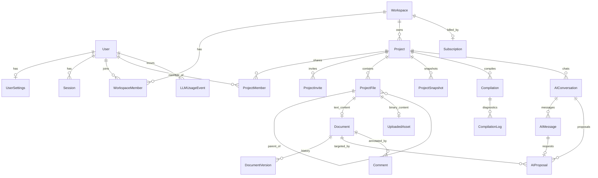

# DATABASE_DESIGN.md

PostgreSQL 17 + Prisma ORM 7.x. All primary keys are UUIDv7 (`@default(uuid(7))`, time-ordered → index-friendly). All timestamps are `timestamptz`. Table/column names are `snake_case` via `@map`/`@@map`.

> **Prisma 7 notes (verify against current Prisma docs at scaffold time):** the generator is `prisma-client` with a required `output`; the connection URL lives in `prisma.config.ts` (not in `schema.prisma`); runtime uses a driver adapter (`@prisma/adapter-pg`). Prisma cannot express **partial unique indexes** or **CHECK constraints** in the schema file, so these are added in hand-written SQL migrations (§6). Pin `prisma` and `@prisma/client` to the same exact 7.x version.

---

## 1. Design decisions

| Decision | Rationale |
|---|---|
| Text sources (`.tex`, `.bib`, `.sty`, …) in Postgres `TEXT` | Transactional revision checks, simple diffing, AI proposals and versions need atomic multi-row updates with the document. Typical files are tens of KB; ≤ 2 MiB cap. |
| Binaries (images, PDFs, fonts, generated PDFs, logs) in R2 | Never in Postgres. Postgres stores metadata + object key. |
| `ProjectFile` = tree node; `Document` = text content; `UploadedAsset` = binary metadata | One uniform tree for the explorer; content storage differs by kind. |
| Materialized `path` on `ProjectFile` | Compile manifests and path uniqueness need full paths; rename/move updates descendants in one transaction. |
| Revision integer + SHA-256 hash on `Document` | Optimistic concurrency and AI-proposal staleness checks. Revision is the primary guard; hash detects accidental divergence (e.g., client bug). |
| Full-text `DocumentVersion` snapshots | Simple, restore is trivial; TOAST compression keeps size reasonable; throttled by policy (§8.4). |
| At most one *active* AI proposal per document | Partial unique index (§6) makes "two concurrent proposals" impossible at the DB level. |
| Soft delete for files/projects/users; physical R2 deletion via outbox | Recoverability + consistency (`STORAGE_ARCHITECTURE.md` §9). |
| Workspaces exist in schema from day one; MVP uses one personal workspace per user | Avoids a later migration of ownership. |

## 2. Entity overview

| Entity | Purpose | MVP |
|---|---|---|
| `User`, `UserSettings`, `Session`, `VerificationToken` | Identity, preferences, refresh-token families, email/password flows | ✔ |
| `Workspace`, `WorkspaceMember` | Ownership / grouping | ✔ (personal only) |
| `Project`, `ProjectMember`, `ProjectInvite` | Projects and sharing | ✔ (invite flow can be minimal) |
| `ProjectFile` | File/folder tree node | ✔ |
| `Document` | Current text of a text file + revision | ✔ |
| `UploadedAsset` | Binary file metadata + R2 key | ✔ |
| `DocumentVersion`, `ProjectSnapshot` | History | ✔ / snapshot post-MVP |
| `Compilation`, `CompilationLog` | Compile runs and parsed diagnostics | ✔ |
| `AIConversation`, `AIMessage`, `AIProposal` | AI chat and approval workflow | ✔ |
| `LLMUsageEvent` | Token and cost accounting | ✔ |
| `Comment` | Annotations | post-MVP (table can ship later) |
| `Subscription` | Monetization | post-MVP |
| `AuditLog`, `StorageDeletionTask` | Security audit; R2 deletion outbox | ✔ |

## 3. ER diagram



## 4. Prisma schema (complete, proposed)

```prisma
// packages/db/prisma/schema.prisma
generator client {
  provider = "prisma-client"
  output   = "../src/generated/prisma"
}

datasource db {
  provider = "postgresql"
  // Prisma 7: connection URL is configured in prisma.config.ts
}

// ───────────── Enums ─────────────
enum WorkspaceRole       { OWNER ADMIN MEMBER }
enum ProjectRole         { OWNER EDITOR COMMENTER VIEWER }
enum InviteStatus        { PENDING ACCEPTED REVOKED EXPIRED }
enum FileNodeType        { FILE FOLDER }
enum FileKind            { TEXT BINARY }
enum LatexEngine         { PDFLATEX XELATEX LUALATEX }
enum BibTool             { AUTO BIBTEX BIBER NONE }
enum AssetStatus         { PENDING READY DELETING DELETED FAILED }
enum VersionSource       { CHECKPOINT MANUAL PRE_AI AI_ACCEPT PRE_RESTORE RESTORE IMPORT }
enum CompilationStatus   { QUEUED RUNNING SUCCEEDED FAILED TIMED_OUT CANCELLED SUPERSEDED }
enum CompilationTrigger  { MANUAL AUTO AI_ACCEPT RESTORE }
enum DiagnosticLevel     { ERROR WARNING INFO }
enum MessageRole         { USER ASSISTANT SYSTEM }
enum ProposalStatus      { QUEUED GENERATING PENDING ACCEPTED REJECTED STALE SUPERSEDED FAILED CANCELLED EXPIRED }
enum TokenType           { EMAIL_VERIFY PASSWORD_RESET }
enum Plan                { FREE PRO TEAM }
enum SubscriptionStatus  { TRIALING ACTIVE PAST_DUE CANCELED INCOMPLETE }

// ───────────── Identity ─────────────
model User {
  id              String    @id @default(uuid(7)) @db.Uuid
  email           String    @unique // stored lowercase; CHECK (email = lower(email)) in SQL migration
  name            String    @db.VarChar(120)
  passwordHash    String?   @map("password_hash")
  avatarKey       String?   @map("avatar_key")
  emailVerifiedAt DateTime? @map("email_verified_at") @db.Timestamptz(6)
  disabledAt      DateTime? @map("disabled_at") @db.Timestamptz(6)
  lastLoginAt     DateTime? @map("last_login_at") @db.Timestamptz(6)
  createdAt       DateTime  @default(now()) @map("created_at") @db.Timestamptz(6)
  updatedAt       DateTime  @updatedAt @map("updated_at") @db.Timestamptz(6)
  deletedAt       DateTime? @map("deleted_at") @db.Timestamptz(6)

  settings             UserSettings?
  sessions             Session[]
  verificationTokens   VerificationToken[]
  workspaceMemberships WorkspaceMember[]
  projectMemberships   ProjectMember[]
  projectsCreated      Project[]         @relation("ProjectCreator")
  invitesSent          ProjectInvite[]
  filesCreated         ProjectFile[]     @relation("FileCreator")
  documentsUpdated     Document[]        @relation("DocumentUpdater")
  versionsCreated      DocumentVersion[]
  snapshotsCreated     ProjectSnapshot[]
  assetsUploaded       UploadedAsset[]
  compilations         Compilation[]
  conversations        AIConversation[]
  proposalsResolved    AIProposal[]      @relation("ProposalResolver")
  comments             Comment[]
  usageEvents          LLMUsageEvent[]
  auditLogs            AuditLog[]

  @@map("users")
}

model UserSettings {
  userId         String   @id @map("user_id") @db.Uuid
  theme          String   @default("system") @db.VarChar(16)      // system|light|dark
  editorFontSize Int      @default(14) @map("editor_font_size")
  keymap         String   @default("default") @db.VarChar(16)     // default|vim|emacs
  defaultModelId String?  @map("default_model_id") @db.VarChar(80)
  autoCompile    Boolean  @default(false) @map("auto_compile")
  layout         Json?                                             // panel sizes/visibility
  updatedAt      DateTime @updatedAt @map("updated_at") @db.Timestamptz(6)

  user User @relation(fields: [userId], references: [id], onDelete: Cascade)
  @@map("user_settings")
}

model Session {
  id           String    @id @default(uuid(7)) @db.Uuid
  userId       String    @map("user_id") @db.Uuid
  familyId     String    @map("family_id") @db.Uuid               // refresh-token rotation family
  tokenHash    String    @unique @map("token_hash")               // SHA-256 of opaque refresh token
  userAgent    String?   @map("user_agent") @db.VarChar(400)
  ipAddress    String?   @map("ip_address") @db.VarChar(64)
  createdAt    DateTime  @default(now()) @map("created_at") @db.Timestamptz(6)
  lastUsedAt   DateTime  @default(now()) @map("last_used_at") @db.Timestamptz(6)
  expiresAt    DateTime  @map("expires_at") @db.Timestamptz(6)
  revokedAt    DateTime? @map("revoked_at") @db.Timestamptz(6)
  replacedById String?   @map("replaced_by_id") @db.Uuid

  user User @relation(fields: [userId], references: [id], onDelete: Cascade)
  @@index([userId])
  @@index([familyId])
  @@index([expiresAt])
  @@map("sessions")
}

model VerificationToken {
  id        String    @id @default(uuid(7)) @db.Uuid
  userId    String    @map("user_id") @db.Uuid
  type      TokenType
  tokenHash String    @unique @map("token_hash")
  expiresAt DateTime  @map("expires_at") @db.Timestamptz(6)
  usedAt    DateTime? @map("used_at") @db.Timestamptz(6)
  createdAt DateTime  @default(now()) @map("created_at") @db.Timestamptz(6)

  user User @relation(fields: [userId], references: [id], onDelete: Cascade)
  @@index([userId, type])
  @@map("verification_tokens")
}

// ───────────── Workspaces & projects ─────────────
model Workspace {
  id         String   @id @default(uuid(7)) @db.Uuid
  name       String   @db.VarChar(120)
  slug       String   @unique @db.VarChar(60)
  isPersonal Boolean  @default(false) @map("is_personal")
  createdAt  DateTime @default(now()) @map("created_at") @db.Timestamptz(6)
  updatedAt  DateTime @updatedAt @map("updated_at") @db.Timestamptz(6)
  deletedAt  DateTime? @map("deleted_at") @db.Timestamptz(6)

  members      WorkspaceMember[]
  projects     Project[]
  subscription Subscription?
  usageEvents  LLMUsageEvent[]
  @@map("workspaces")
}

model WorkspaceMember {
  workspaceId String        @map("workspace_id") @db.Uuid
  userId      String        @map("user_id") @db.Uuid
  role        WorkspaceRole @default(MEMBER)
  createdAt   DateTime      @default(now()) @map("created_at") @db.Timestamptz(6)

  workspace Workspace @relation(fields: [workspaceId], references: [id], onDelete: Cascade)
  user      User      @relation(fields: [userId], references: [id], onDelete: Cascade)
  @@id([workspaceId, userId])
  @@index([userId])
  @@map("workspace_members")
}

model Project {
  id           String      @id @default(uuid(7)) @db.Uuid
  workspaceId  String      @map("workspace_id") @db.Uuid
  createdById  String      @map("created_by_id") @db.Uuid
  name         String      @db.VarChar(160)
  description  String?     @db.VarChar(1000)
  engine       LatexEngine @default(PDFLATEX)
  bibTool      BibTool     @default(AUTO) @map("bib_tool")
  mainFileId   String?     @unique @map("main_file_id") @db.Uuid
  autoCompile  Boolean     @default(false) @map("auto_compile")
  storageBytes BigInt      @default(0) @map("storage_bytes")      // denormalized; reconciled nightly
  templateKey  String?     @map("template_key") @db.VarChar(60)
  createdAt    DateTime    @default(now()) @map("created_at") @db.Timestamptz(6)
  updatedAt    DateTime    @updatedAt @map("updated_at") @db.Timestamptz(6)
  trashedAt    DateTime?   @map("trashed_at") @db.Timestamptz(6)

  workspace     Workspace         @relation(fields: [workspaceId], references: [id], onDelete: Restrict)
  createdBy     User              @relation("ProjectCreator", fields: [createdById], references: [id], onDelete: Restrict)
  mainFile      ProjectFile?      @relation("ProjectMainFile", fields: [mainFileId], references: [id], onDelete: SetNull)
  members       ProjectMember[]
  invites       ProjectInvite[]
  files         ProjectFile[]     @relation("ProjectFiles")
  documents     Document[]
  assets        UploadedAsset[]
  snapshots     ProjectSnapshot[]
  compilations  Compilation[]
  conversations AIConversation[]
  comments      Comment[]

  @@index([workspaceId, trashedAt])
  @@index([createdById])
  @@map("projects")
}

model ProjectMember {
  projectId    String      @map("project_id") @db.Uuid
  userId       String      @map("user_id") @db.Uuid
  role         ProjectRole
  lastOpenedAt DateTime?   @map("last_opened_at") @db.Timestamptz(6)
  createdAt    DateTime    @default(now()) @map("created_at") @db.Timestamptz(6)

  project Project @relation(fields: [projectId], references: [id], onDelete: Cascade)
  user    User    @relation(fields: [userId], references: [id], onDelete: Cascade)
  @@id([projectId, userId])
  @@index([userId, lastOpenedAt])
  @@map("project_members")
}

model ProjectInvite {
  id          String       @id @default(uuid(7)) @db.Uuid
  projectId   String       @map("project_id") @db.Uuid
  invitedById String       @map("invited_by_id") @db.Uuid
  email       String
  role        ProjectRole
  tokenHash   String       @unique @map("token_hash")
  status      InviteStatus @default(PENDING)
  expiresAt   DateTime     @map("expires_at") @db.Timestamptz(6)
  createdAt   DateTime     @default(now()) @map("created_at") @db.Timestamptz(6)

  project   Project @relation(fields: [projectId], references: [id], onDelete: Cascade)
  invitedBy User    @relation(fields: [invitedById], references: [id], onDelete: Cascade)
  @@index([projectId, status])
  @@index([email])
  @@map("project_invites")
}

// ───────────── Files, documents, assets ─────────────
model ProjectFile {
  id          String       @id @default(uuid(7)) @db.Uuid
  projectId   String       @map("project_id") @db.Uuid
  parentId    String?      @map("parent_id") @db.Uuid
  name        String       @db.VarChar(255)
  path        String       @db.VarChar(1024)                       // normalized, no leading slash, '/' separators
  nodeType    FileNodeType @map("node_type")
  kind        FileKind?                                              // null for folders
  mimeType    String?      @map("mime_type") @db.VarChar(120)
  sizeBytes   BigInt       @default(0) @map("size_bytes")
  createdById String       @map("created_by_id") @db.Uuid
  createdAt   DateTime     @default(now()) @map("created_at") @db.Timestamptz(6)
  updatedAt   DateTime     @updatedAt @map("updated_at") @db.Timestamptz(6)
  deletedAt   DateTime?    @map("deleted_at") @db.Timestamptz(6)

  project   Project         @relation("ProjectFiles", fields: [projectId], references: [id], onDelete: Cascade)
  parent    ProjectFile?    @relation("FileTree", fields: [parentId], references: [id], onDelete: Restrict)
  children  ProjectFile[]   @relation("FileTree")
  createdBy User            @relation("FileCreator", fields: [createdById], references: [id], onDelete: Restrict)
  document  Document?
  asset     UploadedAsset?
  mainOf    Project?        @relation("ProjectMainFile")

  // Partial unique (project_id, path) WHERE deleted_at IS NULL is added in SQL (see §6).
  @@index([projectId, parentId])
  @@index([projectId, deletedAt])
  @@map("project_files")
}

model Document {
  id          String   @id @default(uuid(7)) @db.Uuid
  fileId      String   @unique @map("file_id") @db.Uuid
  projectId   String   @map("project_id") @db.Uuid               // denormalized for authz-scoped queries
  content     String                                                // @db.Text implicit for String in PG; LF-normalized, UTF-8, no NUL
  contentHash String   @map("content_hash") @db.Char(64)           // SHA-256 hex of content
  revision    Int      @default(1)
  sizeBytes   Int      @map("size_bytes")
  symbols     Json?                                                 // parsed index: sections, labels, cites, inputs, packages
  updatedById String?  @map("updated_by_id") @db.Uuid
  createdAt   DateTime @default(now()) @map("created_at") @db.Timestamptz(6)
  updatedAt   DateTime @updatedAt @map("updated_at") @db.Timestamptz(6)

  file      ProjectFile       @relation(fields: [fileId], references: [id], onDelete: Cascade)
  project   Project           @relation(fields: [projectId], references: [id], onDelete: Cascade)
  updatedBy User?             @relation("DocumentUpdater", fields: [updatedById], references: [id], onDelete: SetNull)
  versions  DocumentVersion[]
  proposals AIProposal[]
  comments  Comment[]

  @@index([projectId])
  @@map("documents")
}

model DocumentVersion {
  id          String        @id @default(uuid(7)) @db.Uuid
  documentId  String        @map("document_id") @db.Uuid
  revision    Int
  content     String
  contentHash String        @map("content_hash") @db.Char(64)
  sizeBytes   Int           @map("size_bytes")
  source      VersionSource
  label       String?       @db.VarChar(160)
  proposalId  String?       @map("proposal_id") @db.Uuid
  createdById String?       @map("created_by_id") @db.Uuid
  createdAt   DateTime      @default(now()) @map("created_at") @db.Timestamptz(6)

  document  Document  @relation(fields: [documentId], references: [id], onDelete: Cascade)
  createdBy User?     @relation(fields: [createdById], references: [id], onDelete: SetNull)
  @@unique([documentId, revision])
  @@index([documentId, createdAt(sort: Desc)])
  @@map("document_versions")
}

model ProjectSnapshot {
  id          String   @id @default(uuid(7)) @db.Uuid
  projectId   String   @map("project_id") @db.Uuid
  createdById String?  @map("created_by_id") @db.Uuid
  label       String   @db.VarChar(160)
  manifest    Json                                                  // [{fileId, path, kind, documentVersionId?, assetId?, sha256?}]
  createdAt   DateTime @default(now()) @map("created_at") @db.Timestamptz(6)

  project   Project @relation(fields: [projectId], references: [id], onDelete: Cascade)
  createdBy User?   @relation(fields: [createdById], references: [id], onDelete: SetNull)
  @@index([projectId, createdAt(sort: Desc)])
  @@map("project_snapshots")
}

model UploadedAsset {
  id           String      @id @default(uuid(7)) @db.Uuid
  projectId    String      @map("project_id") @db.Uuid
  fileId       String      @unique @map("file_id") @db.Uuid
  uploadedById String      @map("uploaded_by_id") @db.Uuid
  status       AssetStatus @default(PENDING)
  objectKey    String      @unique @map("object_key") @db.VarChar(512)
  originalName String      @map("original_name") @db.VarChar(255)
  mimeType     String      @map("mime_type") @db.VarChar(120)        // server-sniffed, not client-claimed
  sizeBytes    BigInt      @map("size_bytes")
  sha256       String?     @db.Char(64)
  width        Int?
  height       Int?
  createdAt    DateTime    @default(now()) @map("created_at") @db.Timestamptz(6)
  readyAt      DateTime?   @map("ready_at") @db.Timestamptz(6)
  deletedAt    DateTime?   @map("deleted_at") @db.Timestamptz(6)

  project    Project     @relation(fields: [projectId], references: [id], onDelete: Cascade)
  file       ProjectFile @relation(fields: [fileId], references: [id], onDelete: Cascade)
  uploadedBy User        @relation(fields: [uploadedById], references: [id], onDelete: Restrict)
  @@index([projectId, status])
  @@index([status, createdAt])                                      // PENDING reaper
  @@map("uploaded_assets")
}

// ───────────── Compilation ─────────────
model Compilation {
  id              String             @id @default(uuid(7)) @db.Uuid
  projectId       String             @map("project_id") @db.Uuid
  requestedById   String?            @map("requested_by_id") @db.Uuid
  status          CompilationStatus  @default(QUEUED)
  trigger         CompilationTrigger @default(MANUAL)
  engine          LatexEngine
  bibTool         BibTool            @map("bib_tool")
  mainFilePath    String             @map("main_file_path") @db.VarChar(1024)
  inputHash       String             @map("input_hash") @db.Char(64) // SHA-256 over manifest + engine + main + limits version
  inputsKey       String?            @map("inputs_key")              // R2 key of text bundle
  docRevisions    Json               @map("doc_revisions")           // {documentId: revision} captured at request time
  cacheHitOfId    String?            @map("cache_hit_of_id") @db.Uuid
  bullJobId       String?            @map("bull_job_id")
  workerId        String?            @map("worker_id")
  queuedAt        DateTime           @default(now()) @map("queued_at") @db.Timestamptz(6)
  startedAt       DateTime?          @map("started_at") @db.Timestamptz(6)
  finishedAt      DateTime?          @map("finished_at") @db.Timestamptz(6)
  durationMs      Int?               @map("duration_ms")
  exitCode        Int?               @map("exit_code")
  errorCode       String?            @map("error_code") @db.VarChar(60) // TIMEOUT|OOM|INFRA|OUTPUT_TOO_LARGE|NO_PDF|...
  pdfKey          String?            @map("pdf_key")
  pdfSizeBytes    BigInt?            @map("pdf_size_bytes")
  pageCount       Int?               @map("page_count")
  synctexKey      String?            @map("synctex_key")
  logKey          String?            @map("log_key")
  errorCount      Int                @default(0) @map("error_count")
  warningCount    Int                @default(0) @map("warning_count")

  project     Project          @relation(fields: [projectId], references: [id], onDelete: Cascade)
  requestedBy User?            @relation(fields: [requestedById], references: [id], onDelete: SetNull)
  logs        CompilationLog[]

  @@index([projectId, queuedAt(sort: Desc)])
  @@index([projectId, inputHash])
  @@index([status, queuedAt])                                        // reconciler
  @@map("compilations")
}

model CompilationLog {
  id            String          @id @default(uuid(7)) @db.Uuid
  compilationId String          @map("compilation_id") @db.Uuid
  ordinal       Int
  level         DiagnosticLevel
  file          String?         @db.VarChar(1024)
  line          Int?
  message       String          @db.VarChar(2000)
  context       String?         @db.VarChar(2000)                    // bounded raw log excerpt
  kind          String?         @db.VarChar(40)                      // undefined-control-sequence|missing-file|overfull-hbox|...

  compilation Compilation @relation(fields: [compilationId], references: [id], onDelete: Cascade)
  @@unique([compilationId, ordinal])
  @@index([compilationId, level])
  @@map("compilation_logs")
}

// ───────────── AI ─────────────
model AIConversation {
  id         String    @id @default(uuid(7)) @db.Uuid
  projectId  String    @map("project_id") @db.Uuid
  userId     String    @map("user_id") @db.Uuid
  title      String?   @db.VarChar(160)
  createdAt  DateTime  @default(now()) @map("created_at") @db.Timestamptz(6)
  updatedAt  DateTime  @updatedAt @map("updated_at") @db.Timestamptz(6)
  archivedAt DateTime? @map("archived_at") @db.Timestamptz(6)

  project   Project      @relation(fields: [projectId], references: [id], onDelete: Cascade)
  user      User         @relation(fields: [userId], references: [id], onDelete: Cascade)
  messages  AIMessage[]
  proposals AIProposal[]
  @@index([projectId, userId, updatedAt(sort: Desc)])
  @@map("ai_conversations")
}

model AIMessage {
  id             String      @id @default(uuid(7)) @db.Uuid
  conversationId String      @map("conversation_id") @db.Uuid
  role           MessageRole
  content        String
  mode           String?     @db.VarChar(16)                          // edit|ask
  provider       String?     @db.VarChar(40)
  model          String?     @db.VarChar(80)
  context        Json?                                                // what the user attached: file ids, selection range
  createdAt      DateTime    @default(now()) @map("created_at") @db.Timestamptz(6)

  conversation AIConversation @relation(fields: [conversationId], references: [id], onDelete: Cascade)
  proposal     AIProposal?
  @@index([conversationId, createdAt])
  @@map("ai_messages")
}

model AIProposal {
  id                  String         @id @default(uuid(7)) @db.Uuid
  conversationId      String         @map("conversation_id") @db.Uuid
  requestMessageId    String         @unique @map("request_message_id") @db.Uuid
  responseMessageId   String?        @unique @map("response_message_id") @db.Uuid
  documentId          String         @map("document_id") @db.Uuid
  status              ProposalStatus @default(QUEUED)
  baseRevision        Int            @map("base_revision")
  baseContentHash     String         @map("base_content_hash") @db.Char(64)
  provider            String         @db.VarChar(40)
  model               String         @db.VarChar(80)
  promptVersion       String         @map("prompt_version") @db.VarChar(20)
  scope               Json?                                             // {kind:"file"|"selection"|"section", from?, to?}
  contextManifest     Json?          @map("context_manifest")           // ids/hashes/sizes of context sent (not the content)
  editOps             Json?          @map("edit_ops")                   // validated structured edits
  proposedContent     String?        @map("proposed_content")
  proposedContentHash String?        @map("proposed_content_hash") @db.Char(64)
  summary             String?        @db.VarChar(2000)
  diffStats           Json?          @map("diff_stats")                 // {added, removed, hunks}
  validation          Json?                                             // [{severity, code, message}]
  errorCode           String?        @map("error_code") @db.VarChar(60)
  errorMessage        String?        @map("error_message") @db.VarChar(1000)
  tokensIn            Int?           @map("tokens_in")
  tokensOut           Int?           @map("tokens_out")
  costMicros          BigInt?        @map("cost_micros")
  latencyMs           Int?           @map("latency_ms")
  resolvedById        String?        @map("resolved_by_id") @db.Uuid
  resolvedAt          DateTime?      @map("resolved_at") @db.Timestamptz(6)
  resultRevision      Int?           @map("result_revision")            // document revision created by accept
  expiresAt           DateTime?      @map("expires_at") @db.Timestamptz(6)
  createdAt           DateTime       @default(now()) @map("created_at") @db.Timestamptz(6)
  updatedAt           DateTime       @updatedAt @map("updated_at") @db.Timestamptz(6)

  conversation    AIConversation @relation(fields: [conversationId], references: [id], onDelete: Cascade)
  requestMessage  AIMessage        @relation(fields: [requestMessageId], references: [id], onDelete: Cascade)
  document        Document         @relation(fields: [documentId], references: [id], onDelete: Cascade)
  resolvedBy      User?            @relation("ProposalResolver", fields: [resolvedById], references: [id], onDelete: SetNull)

  // Partial unique: one active proposal per document (see §6)
  @@index([documentId, status])
  @@index([conversationId, createdAt])
  @@index([status, expiresAt])
  @@map("ai_proposals")
}

model LLMUsageEvent {
  id          String   @id @default(uuid(7)) @db.Uuid
  workspaceId String   @map("workspace_id") @db.Uuid
  userId      String   @map("user_id") @db.Uuid
  proposalId  String?  @map("proposal_id") @db.Uuid
  provider    String   @db.VarChar(40)
  model       String   @db.VarChar(80)
  tokensIn    Int      @map("tokens_in")
  tokensOut   Int      @map("tokens_out")
  tokensCached Int?    @map("tokens_cached")
  costMicros  BigInt   @map("cost_micros")                          // USD micro-dollars at time of call
  latencyMs   Int      @map("latency_ms")
  success     Boolean
  createdAt   DateTime @default(now()) @map("created_at") @db.Timestamptz(6)

  workspace Workspace @relation(fields: [workspaceId], references: [id], onDelete: Cascade)
  user      User      @relation(fields: [userId], references: [id], onDelete: Cascade)
  @@index([workspaceId, createdAt])
  @@index([userId, createdAt])
  @@map("llm_usage_events")
}

// ───────────── Collaboration & business (post-MVP tables, schema-ready) ─────────────
model Comment {
  id         String    @id @default(uuid(7)) @db.Uuid
  projectId  String    @map("project_id") @db.Uuid
  documentId String    @map("document_id") @db.Uuid
  authorId   String    @map("author_id") @db.Uuid
  parentId   String?   @map("parent_id") @db.Uuid
  body       String    @db.VarChar(4000)
  anchor     Json                                                    // {revision, from, to, quote}
  resolvedAt DateTime? @map("resolved_at") @db.Timestamptz(6)
  createdAt  DateTime  @default(now()) @map("created_at") @db.Timestamptz(6)
  updatedAt  DateTime  @updatedAt @map("updated_at") @db.Timestamptz(6)
  deletedAt  DateTime? @map("deleted_at") @db.Timestamptz(6)

  project  Project   @relation(fields: [projectId], references: [id], onDelete: Cascade)
  document Document  @relation(fields: [documentId], references: [id], onDelete: Cascade)
  author   User      @relation(fields: [authorId], references: [id], onDelete: Cascade)
  parent   Comment?  @relation("CommentThread", fields: [parentId], references: [id], onDelete: Cascade)
  replies  Comment[] @relation("CommentThread")
  @@index([documentId, resolvedAt])
  @@index([projectId])
  @@map("comments")
}

model Subscription {
  id                     String             @id @default(uuid(7)) @db.Uuid
  workspaceId            String             @unique @map("workspace_id") @db.Uuid
  plan                   Plan               @default(FREE)
  status                 SubscriptionStatus @default(ACTIVE)
  provider               String             @default("stripe") @db.VarChar(20)
  providerCustomerId     String?            @map("provider_customer_id")
  providerSubscriptionId String?            @unique @map("provider_subscription_id")
  currentPeriodStart     DateTime?          @map("current_period_start") @db.Timestamptz(6)
  currentPeriodEnd       DateTime?          @map("current_period_end") @db.Timestamptz(6)
  cancelAtPeriodEnd      Boolean            @default(false) @map("cancel_at_period_end")
  createdAt              DateTime           @default(now()) @map("created_at") @db.Timestamptz(6)
  updatedAt              DateTime           @updatedAt @map("updated_at") @db.Timestamptz(6)

  workspace Workspace @relation(fields: [workspaceId], references: [id], onDelete: Cascade)
  @@map("subscriptions")
}

// ───────────── Operations ─────────────
model AuditLog {
  id         String   @id @default(uuid(7)) @db.Uuid
  actorId    String?  @map("actor_id") @db.Uuid
  action     String   @db.VarChar(80)                                // e.g. project.member.add, ai.proposal.accept
  targetType String   @map("target_type") @db.VarChar(40)
  targetId   String?  @map("target_id") @db.Uuid
  metadata   Json?
  ipAddress  String?  @map("ip_address") @db.VarChar(64)
  createdAt  DateTime @default(now()) @map("created_at") @db.Timestamptz(6)

  actor User? @relation(fields: [actorId], references: [id], onDelete: SetNull)
  @@index([actorId, createdAt])
  @@index([targetType, targetId])
  @@map("audit_logs")
}

model StorageDeletionTask {
  id          String    @id @default(uuid(7)) @db.Uuid
  objectKey   String    @map("object_key") @db.VarChar(512)
  reason      String    @db.VarChar(60)
  runAfter    DateTime  @default(now()) @map("run_after") @db.Timestamptz(6)
  attempts    Int       @default(0)
  lastError   String?   @map("last_error") @db.VarChar(500)
  completedAt DateTime? @map("completed_at") @db.Timestamptz(6)
  createdAt   DateTime  @default(now()) @map("created_at") @db.Timestamptz(6)

  @@index([completedAt, runAfter])
  @@map("storage_deletion_tasks")
}
```

## 5. Entity reference (fields, keys, constraints, validation)

Types, PKs, FKs and indexes are defined by the schema above. This table adds **uniqueness and validation rules** not obvious from the schema.

| Entity | Unique constraints | Validation rules (enforced in Zod + service; DB CHECK where noted) |
|---|---|---|
| `User` | `email` | lowercase email (CHECK); password 10–128 chars, not in top-10k breached list; name 1–120 |
| `Session` | `tokenHash` | `expiresAt > createdAt`; at most 20 active sessions/user (oldest revoked) |
| `Workspace` | `slug` | slug `^[a-z0-9-]{3,60}$` |
| `WorkspaceMember` | `(workspaceId,userId)` | ≥ 1 OWNER per workspace (service-enforced in transaction) |
| `Project` | — | name 1–160; `mainFileId` must reference a TEXT `.tex` file in same project (service); ≤ 100 projects/user (plan) |
| `ProjectMember` | `(projectId,userId)` | exactly ≥ 1 OWNER (service); cannot demote last owner |
| `ProjectFile` | partial `(projectId, path) WHERE deleted_at IS NULL` | name: no `/ \ : * ? " < > |`, not `.`/`..`, no leading dot except `.gitkeep`-style allowlist, ≤ 255 bytes; depth ≤ 12; path ≤ 1024; extension allowlist (see `STORAGE_ARCHITECTURE.md` §5) ; case-insensitive uniqueness within folder (service) so `Fig.png`/`fig.png` cannot coexist (TeX on case-sensitive FS vs user machines) |
| `Document` | `fileId` | UTF-8, no NUL, LF-normalized, ≤ 2 MiB (CHECK `size_bytes <= 2097152`); `revision ≥ 1` (CHECK) |
| `DocumentVersion` | `(documentId, revision)` | immutable (no UPDATE; enforced by service and a trigger in hardening) |
| `UploadedAsset` | `objectKey`, `fileId` | `status=READY` ⇒ `sha256`, `sizeBytes`, sniffed `mimeType` present (CHECK) |
| `Compilation` | — | `finishedAt ≥ startedAt ≥ queuedAt`; terminal statuses immutable (service) |
| `CompilationLog` | `(compilationId, ordinal)` | ≤ 500 rows/compilation (worker truncates, adds a final INFO "truncated") |
| `AIConversation` | — | ≤ 50 active per project/user |
| `AIProposal` | `requestMessageId`, partial *active* unique | `status=PENDING` ⇒ `proposedContent` + `proposedContentHash` + `editOps` non-null (CHECK); terminal statuses immutable except `updatedAt` |
| `LLMUsageEvent` | — | append-only |
| `Comment` | — | body 1–4000; anchor shape validated by Zod |
| `Subscription` | `workspaceId`, `providerSubscriptionId` | webhook-driven only |

## 6. Raw-SQL migration content (cannot be expressed in Prisma)

Place in a dedicated migration (e.g., `YYYYMMDD_constraints/migration.sql`) created with `prisma migrate dev --create-only`, then edited by hand.

```sql
-- Unique live path per project
CREATE UNIQUE INDEX project_files_project_path_live_uq
  ON project_files (project_id, path) WHERE deleted_at IS NULL;

-- Case-insensitive sibling uniqueness
CREATE UNIQUE INDEX project_files_project_path_ci_live_uq
  ON project_files (project_id, lower(path)) WHERE deleted_at IS NULL;

-- At most one ACTIVE AI proposal per document
CREATE UNIQUE INDEX ai_proposals_one_active_per_document_uq
  ON ai_proposals (document_id) WHERE status IN ('QUEUED','GENERATING','PENDING');

-- At most one RUNNING compilation per project (QUEUED ones are coalesced by service)
CREATE UNIQUE INDEX compilations_one_running_per_project_uq
  ON compilations (project_id) WHERE status = 'RUNNING';

-- Checks
ALTER TABLE users ADD CONSTRAINT users_email_lower_ck CHECK (email = lower(email));
ALTER TABLE documents ADD CONSTRAINT documents_size_ck CHECK (size_bytes <= 2097152 AND revision >= 1);
ALTER TABLE ai_proposals ADD CONSTRAINT ai_proposals_pending_payload_ck
  CHECK (status <> 'PENDING' OR (proposed_content IS NOT NULL AND proposed_content_hash IS NOT NULL AND edit_ops IS NOT NULL));
ALTER TABLE uploaded_assets ADD CONSTRAINT uploaded_assets_ready_ck
  CHECK (status <> 'READY' OR (sha256 IS NOT NULL AND ready_at IS NOT NULL));

-- Autovacuum tuning for hot, bloat-prone table
ALTER TABLE documents SET (autovacuum_vacuum_scale_factor = 0.02, autovacuum_analyze_scale_factor = 0.02);

-- Search across project files (MVP: trigram; requires pg_trgm)
CREATE EXTENSION IF NOT EXISTS pg_trgm;
CREATE INDEX documents_content_trgm_idx ON documents USING gin (content gin_trgm_ops);
```

> `documents_content_trgm_idx` supports project search (`ILIKE '%term%'`) acceptably up to a few GB total; revisit (e.g., ParadeDB / `tsvector`) only if search latency exceeds targets. Because the GIN index is expensive on a hot-update table, **create it in Phase 10 (search), not earlier**, and measure autosave latency before/after.

## 7. Entity lifecycle rules

- **Project delete:** `trashedAt` set (30-day retention) → hard delete job removes rows (cascade) and enqueues `StorageDeletionTask` rows for every R2 key in the same transaction.
- **File delete:** `deletedAt` set on node and descendants; `Document` rows kept for 30 days (restore). Assets: status `DELETING`, task queued with `runAfter = now + 7 days` (grace) so snapshots/restores still work.
- **User delete:** `deletedAt` + anonymize email/name; owned projects transferred or deleted per user choice; sessions revoked.
- **Compilation retention:** keep last 20 per project + any from last 7 days; older rows' R2 artifacts queued for deletion; `CompilationLog` rows removed with the compilation.
- **AI proposal retention:** `proposedContent` nulled 30 days after terminal state (metadata kept for usage/audit); `PENDING` proposals expire after 24 h → `EXPIRED`.

## 8. Autosave and concurrent editing

### 8.1 Model
Each `Document` has a monotonically increasing `revision`. The browser holds `baseRevision` = last server revision it has seen for that document.

### 8.2 Autosave protocol
1. Editor change → mark `dirty`; debounce 1.5 s (max-wait 10 s); also flush on tab blur, file switch, compile request, AI prompt submit, and `visibilitychange: hidden` (via `fetch(..., {keepalive:true})`).
2. `PUT /documents/:id/content` with `{ baseRevision, content, clientHash }`. Only **one in-flight save per document**; edits made meanwhile are coalesced into the next save.
3. Server (single transaction, row-level lock implicit in `UPDATE`):
   ```sql
   UPDATE documents
      SET content = $1, content_hash = $2, revision = revision + 1,
          size_bytes = $3, symbols = $4, updated_by_id = $5, updated_at = now()
    WHERE id = $6 AND revision = $7
   RETURNING revision, content_hash;
   ```
   0 rows → re-select to distinguish `404` from `409 REVISION_CONFLICT` (response includes `serverRevision`, `serverHash`; content only if requested).
4. No-op saves (hash equals current) return `200` without incrementing revision.
5. After commit: emit `document.revision.changed` to `project:{id}` (excluding the sender's socket) and optionally enqueue auto-compile.

### 8.3 Conflict handling (user-visible)
- **Another tab/device saved first** → banner: *"This file changed elsewhere."* Actions: **Reload server version** (discard local), **Keep mine & overwrite** (re-save with fresh `baseRevision` after confirm), **Compare** (diff view local vs server).
- Local unsaved text is always retained in IndexedDB (`draft:{documentId}` with `baseRevision`) until a save succeeds. On load, if a draft exists whose `baseRevision` < server revision → conflict prompt; if equal → silent restore.
- **Single-writer hint:** `document.focus` events let other clients display "Alice is editing" (presence-lite) to reduce conflicts before real-time collaboration exists.

### 8.4 Version snapshot policy
`DocumentVersion` rows are created (skipping if `contentHash` equals the latest version):
- `CHECKPOINT`: on a save when ≥ 10 min elapsed since the last version and the content changed.
- `PRE_AI` + `AI_ACCEPT`: inside the accept transaction (§9).
- `PRE_RESTORE` + `RESTORE`: inside restore transaction.
- `MANUAL`: user-labeled.
Retention: all versions 30 days; afterwards thin to the newest per day for 12 months; labeled/MANUAL/AI_ACCEPT versions are kept for the plan's history window. (Free: 30 days; paid: 12 months.)

## 9. AI proposal data rules (see `AI_ARCHITECTURE.md` for workflow)

- A proposal binds to `(documentId, baseRevision, baseContentHash)` at creation.
- **Accept transaction** (all-or-nothing):
  1. `SELECT … FROM ai_proposals WHERE id = ? FOR UPDATE`; require `status = PENDING`, not expired.
  2. `UPDATE documents SET content = proposed, content_hash = …, revision = revision + 1 … WHERE id = ? AND revision = proposal.base_revision AND content_hash = proposal.base_content_hash`.
  3. 0 rows → set proposal `STALE`, commit, return `409 PROPOSAL_STALE`.
  4. Insert `DocumentVersion` rows `PRE_AI` (base) and `AI_ACCEPT` (new), set proposal `ACCEPTED`, `resultRevision`, `resolvedBy/At`, write `AuditLog`.
- **Reject:** `UPDATE ai_proposals SET status='REJECTED' … WHERE status='PENDING'`; no document write.
- Any successful document save by *anyone* while a proposal is `PENDING` on that document does **not** touch the proposal row; staleness is discovered at accept (authoritative) and pushed to clients via `document.revision.changed` (UX). A background sweeper marks stale proposals `STALE` so the partial unique index is released.

## 10. Indexing summary and query patterns

| Query | Index |
|---|---|
| List my projects, recent first | `project_members(user_id, last_opened_at)` + `projects(workspace_id, trashed_at)` |
| File tree for a project | `project_files(project_id, deleted_at)` (load all, build tree client-side; ≤ 500 nodes) |
| Load document | PK on `documents` / `documents(file_id)` unique |
| Version list | `document_versions(document_id, created_at desc)` |
| Compile history | `compilations(project_id, queued_at desc)` |
| Active proposal for document | partial unique index (§6) |
| Pending-upload reaper | `uploaded_assets(status, created_at)` |
| Outbox runner | `storage_deletion_tasks(completed_at, run_after)` |
| Usage per workspace per month | `llm_usage_events(workspace_id, created_at)` |

## 11. Migration strategy

- Prisma Migrate only; migrations reviewed in PR; **no down migrations** (roll forward).
- **Expand → migrate → contract** for breaking changes: add nullable column/new table → deploy code writing both → backfill → deploy code reading new → drop old in a later release.
- `prisma migrate deploy` runs as a one-off ECS task *before* new app tasks start; migrations must be backward-compatible with the previous app version (N-1).
- Long operations (index builds on `documents`) use `CREATE INDEX CONCURRENTLY` in hand-edited migrations outside a transaction.
- CI applies all migrations to an empty DB and diff-checks `prisma migrate diff` against `schema.prisma`.
- Seed data (dev only): demo user, sample project with `article` template.
