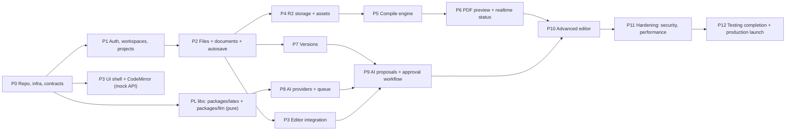

# IMPLEMENTATION_ROADMAP.md

Sequential phases from an empty repository to a production launch. Task IDs (`P3-B2` = Phase 3, Backend task 2) are stable references for coding agents and PRs.

**Resequencing vs. the suggested order:** (1) **R2 storage moves before compilation** because compile artifacts and assets depend on it; (2) the **LaTeX utilities package** (`packages/latex`) and the **LLM package** (`packages/llm`) are built early as pure libraries so they can proceed in parallel; (3) **version history precedes AI** because the approval workflow depends on `PRE_AI`/`AI_ACCEPT` versions; (4) a **contract-freeze step** is added in Phase 0 so parallel streams never block on each other.

## 0. Phase map and dependencies

### Parallelization plan

| Workstream | Owner scope | Can start | Blocking interface |
|---|---|---|---|
| **WS-A Web** (`apps/web`) | UI shell, editor, PDF viewer, AI panel | After P0 contracts | `packages/shared` schemas + OpenAPI; MSW mocks generated from schemas |
| **WS-B Server core** (`apps/server`) | auth, projects, files, documents, versions, AI orchestration | After P0 | DB schema (owned by WS-B) |
| **WS-C Compile** (`apps/compile-runner`, `docker/texlive`) | sandbox image, runner, security suite | After P0 | `CompileJobV1/ResultV1` in `shared` |
| **WS-D LLM** (`packages/llm`) | providers, prompts, `applyEdits` | After P0 | `LLMProvider`, `EditOp` schemas in `shared` |
| **WS-E LaTeX libs** (`packages/latex`) | parsers, validators, command catalog, log parser | After P0 | `SymbolsIndex`, `Diagnostic` types in `shared` |
| **WS-F Infra/DevOps** (`infra`, CI) | Terraform, pipelines, observability | After P0 | env var inventory |

**Must be sequential:** DB migrations (single owner; merge queue ordered), auth before any authenticated feature, P2 before P4/P7, P4 before P5, P7 + P8 before P9. **Conflict prevention:** each package/app has a CODEOWNER; cross-boundary changes go through contract PRs reviewed by both sides (see `CODING_STANDARDS.md` §12).

---

## Phase 0 — Repository, infrastructure and contracts

**Objective:** a green CI on an empty-but-wired monorepo, with contracts frozen.
**Backend tasks**
- P0-B1 Scaffold `apps/server` (Express 5 + TS strict + pino + Zod config loader + health routes).
- P0-B2 Error model (`AppError`, error codes registry), response envelope helpers, request-id middleware.
- P0-B3 BullMQ/Redis and Socket.IO bootstrap with typed queue/event registries (no logic).
**Frontend tasks**
- P0-F1 Scaffold `apps/web` (Next.js 16, Tailwind, shadcn/ui init, theme tokens from UI spec, app shell routes).
- P0-F2 API client generated from OpenAPI + TanStack Query provider + MSW handlers.
**Shared/contract tasks**
- P0-S1 `packages/shared`: error codes, envelope types, pagination, IDs, and **all DTO Zod schemas** for P1–P9 (Auth, Project, File, Document, Compilation, Proposal, Version) + WS event catalog + `CompileJobV1/ResultV1` + `EditOp`/`ProposalDTO`.
- P0-S2 OpenAPI generation script (`pnpm gen:openapi`) + contract-test harness.
**Database tasks**
- P0-D1 `packages/db` with Prisma 7 config, adapter, **full schema from `DATABASE_DESIGN.md`**, initial migration + raw-SQL constraints migration, seed script skeleton.
**Infrastructure tasks**
- P0-I1 pnpm workspace + Turborepo pipeline; `packages/config` (tsconfig/eslint/prettier); dependency-cruiser rules.
- P0-I2 `docker/compose.dev.yml` (Postgres, Redis noeviction, MinIO, Mailpit); `.env.example` per inventory.
- P0-I3 GitHub Actions `ci.yml` (lint, typecheck, unit, integration with Testcontainers, drift check); branch protection; CODEOWNERS; PR template.
- P0-I4 Terraform skeleton (state backend, VPC module stubs) — no apply yet.
**Testing:** smoke tests for config loader, error handler, health route; migration apply test; contract test harness runs.
**Dependencies:** none.
**Deliverables:** repo, CI green, frozen v0 contracts (`CONTRACTS.md` changelog started), dev environment boots with one command.
**Definition of Done:** `pnpm dev` starts all apps; CI required checks pass on a sample PR; schema migrates cleanly; OpenAPI published as CI artifact; boundary lint prevents `compile-runner → db` imports (verified by a failing fixture).

## Phase 1 — Authentication, workspaces and projects

**Objective:** users can register, log in and manage projects.
**Backend:** P1-B1 argon2id password service + breached-list check; P1-B2 JWT service (key loading, `kid` rotation); P1-B3 session service with refresh rotation + reuse detection; P1-B4 auth routes (register/login/refresh/logout/me/verify/reset) + email adapter (SMTP, Mailpit); P1-B5 rate limiters (Redis); P1-B6 `authorize(minRole)` middleware + project role resolver (+cache); P1-B7 workspaces (personal auto-create), projects CRUD, templates loader (6 templates as seed files), members/invites (invite flow may be API-only); P1-B8 audit log writer.
**Frontend:** P1-F1 login/register/verify/reset pages; P1-F2 in-memory access token + silent refresh interceptor; P1-F3 dashboard (list, search, create with template picker, trash/restore); P1-F4 user settings page (basic); P1-F5 route guards.
**Database:** P1-D1 seed templates; indexes verified; P1-D2 repository layer for users/sessions/projects.
**Infra:** P1-I1 mail config; P1-I2 staging environment via Terraform (VPC, RDS, ElastiCache, ECS skeleton, ALB) + first staging deploy workflow.
**Testing:** auth suite (§5 of testing doc), authz matrix generator, E2E journey 1 (signup → project).
**Dependencies:** P0.
**Deliverables:** working auth + dashboard in staging.
**DoD:** all auth security tests pass; refresh-reuse revocation proven; rate limits enforced; projects CRUD with RBAC; staging deploy automated.

## Phase 2 — File explorer backend and document persistence

**Objective:** projects contain files/folders and text documents with revisioned autosave.
**Backend:** P2-B1 path normalization + name validators (shared, unit-tested); P2-B2 file tree service (create/rename/move/delete, descendant path rewrite, main-file logic); P2-B3 document service (`GET`, `PUT content` with conditional update, hash, LF normalization, size caps); P2-B4 `symbols` extraction hook using `packages/latex` (stubbed to empty until PL ready); P2-B5 realtime: `file.tree.changed`, `document.revision.changed`; P2-B6 Socket.IO auth + rooms + `project.join/sync`.
**Frontend:** P2-F1 sidebar file tree (Files tab, context menu, drag-move, inline rename); P2-F2 tab model + document loading store; P2-F3 autosave engine (state machine, IndexedDB drafts, conflict dialog); P2-F4 WS client with reconnect + cache invalidation.
**Database:** P2-D1 index review for tree queries; concurrency tests for revision updates.
**Infra:** P2-I1 WS routing through ALB (idle timeout/stickiness not required); Redis adapter config.
**Testing:** DB concurrency tests (§4), API tests for files/documents, autosave unit tests, E2E journeys 2–3.
**Dependencies:** P1.
**Deliverables:** create/edit/rename/move/delete files; autosave with conflict handling.
**DoD:** 500 concurrent writers → no lost update; conflict flow works in two tabs; local draft recovery verified; tree ops atomic.

## Phase 3 — CodeMirror LaTeX editor and UI shell

**Objective:** IDE-like editing experience matching the reference layout.
**Frontend:** P3-F1 three-panel resizable layout + persisted sizes (UI spec §1); P3-F2 CodeMirror setup (state cache per file, compartments, theme tokens, status bar Ln/Col); P3-F3 LaTeX language (stex StreamLanguage + custom fold service + bracket/indent rules); P3-F4 search/replace, history, keymaps, comment toggle, wrap-selection commands; P3-F5 tab bar behaviours (preview/pinned tabs, dirty/saving indicators, overflow); P3-F6 Outline panel using client-side `packages/latex` outline parser (with title sanitization); P3-F7 autocomplete v1 (static command/environment catalog, package-aware); P3-F8 command palette + quick open; P3-F9 asset preview tabs (image) placeholder.
**Backend:** P3-B1 `GET /projects/:id/index` aggregation (once symbols exist) — can slip to P10.
**Testing:** component tests; editor integration tests (autosave listener, readOnly, folding); perf test on 1 MB document; a11y scan.
**Dependencies:** P2 (document API); WS-E outline parser (`packages/latex`) for P3-F6 — start PL early.
**Deliverables:** usable editor with outline and autocomplete.
**DoD:** keyboard shortcuts per spec; typing latency budget met; outline shows clean titles (screenshot defect case covered by test); lighthouse/a11y checks pass.

## Phase PL — Pure libraries (parallel, start after P0; must finish before P5/P8 integration)

- PL-E1 `packages/latex`: tokenizer/scanner (comments, escapes, verbatim); outline + symbols extractor; title sanitizer; package/preamble parser.
- PL-E2 Log parser with fixtures; diagnostics mapper; ReDoS tests.
- PL-E3 Validators V1–V13 and command catalog JSON.
- PL-D1 `packages/llm`: `LLMProvider` interface, error normalization, retry/backoff/breaker utilities, model catalog, cost calculator.
- PL-D2 `applyEdits` + anchor repair message builder + diff stats; prompt builder `edit.v1` + context budgeter; recorded-fixture harness.
**DoD:** ≥ 90 % coverage; property tests for `applyEdits` (unmentioned text preserved byte-for-byte); no I/O in `packages/latex`.

## Phase 4 — Cloudflare R2 integration and assets

**Objective:** direct-to-R2 uploads and presigned downloads with consistency guarantees.
**Backend:** P4-B1 `StorageService` (R2/MinIO) + key builder + presign + head/range/copy/delete; P4-B2 asset upload init/complete/cancel endpoints + sniffing + dimension checks + quotas; P4-B3 download redirect endpoint; P4-B4 **deletion outbox** table runner (`SKIP LOCKED`) ; P4-B5 PENDING reaper + nightly reconciliation (dry-run flag); P4-B6 project storage accounting.
**Frontend:** P4-F1 upload manager (progress, cancel, retry, concurrency 3, drag-drop onto tree); P4-F2 image/PDF asset preview tab.
**Infra:** P4-I1 R2 buckets, tokens (server/backup), CORS, lifecycle rules, custom user-content domain; P4-I2 backup job (nightly copy).
**Testing:** MinIO contract suite + staging R2 smoke; abandoned-upload tests; orphan scan tests.
**Dependencies:** P2.
**Deliverables:** reliable asset upload/download.
**DoD:** upload failure modes (crash after init, after PUT, wrong magic, oversize) all converge to clean state; outbox retries verified; quotas enforced.

## Phase 5 — LaTeX compilation engine

**Objective:** secure, queue-based compilation producing PDFs, logs, SyncTeX.
**Backend/Runner:** P5-C1 sandbox image (`docker/texlive`: pinned TeX Live, custom `texmf.cnf`, non-root, trimmed tooling); P5-C2 runner app: job validation, input fetch/verify, workdir creation, extraction with path safety; P5-C3 container orchestration via `dockerode` with the fixed hardened flags + deadline + cleanup + reaper; P5-C4 safe output collection + artifact upload via presigned PUT; P5-C5 log parsing → `CompileResultV1`; P5-C6 result publisher to `compile-results`; P5-B1 compilation service (snapshot, manifest, text bundle to R2, `inputHash`, cache hit, coalescing, DB rows, enqueue); P5-B2 results ingestion worker (idempotent, HEAD verification, diagnostics persistence, WS events); P5-B3 reconciler; P5-B4 compile endpoints (start/status/list/log/pdf/cancel).
**Frontend:** P5-F1 compile button + status chip (minimal) wired to REST (WS in P6).
**Database:** P5-D1 compile indexes verified; retention job.
**Infra:** P5-I1 compile node AMI + ASG + SG/subnet isolation + CloudWatch agent; P5-I2 runner systemd unit; P5-I3 queue-depth metric + scaling policy.
**Testing:** golden documents on 3 engines; **full sandbox security suite**; residual-resource checks; stalled-job retry; failure-injection (R2/Redis).
**Dependencies:** P4, PL-E2.
**Deliverables:** compile via API yields PDF in R2 with diagnostics.
**DoD:** security suite 100 % green; p95 compile target met on reference docs; zero leaked containers/dirs after 1,000-compile soak; runner holds no secrets (verified by config audit test).

## Phase 6 — PDF preview and realtime compile status

**Objective:** side-by-side preview with flicker-free refresh.
**Frontend:** P6-F1 PDF.js viewer component (worker, virtualized pages, text layer, zoom, page nav, fullscreen, download); P6-F2 scroll/zoom restore on refresh; P6-F3 status chip states + dropdown (engine, auto-compile, recompile from scratch, stop); P6-F4 Tools panel (problems list, log viewer, settings) + CodeMirror lint markers from diagnostics + scroll marks; P6-F5 auto-compile (debounce after save).
**Backend:** P6-B1 WS events for compile lifecycle; P6-B2 `latest` endpoint; P6-B3 presigned PDF URL caching headers.
**Testing:** E2E journey 1,5; viewer perf with 300 pages; reconnection fallback polling.
**Dependencies:** P5, P3.
**DoD:** compile → PDF refresh without flicker; errors navigable; last good PDF retained on failure.

## Phase 7 — Version history

**Objective:** automatic checkpoints, snapshots, compare, restore (prerequisite for AI).
**Backend:** P7-B1 checkpoint policy in save path (10-min rule, hash dedupe); P7-B2 version endpoints (list/create/get/compare/restore) with restore transaction + `PRE_RESTORE`; P7-B3 retention/thinning job.
**Frontend:** P7-F1 history drawer (list, labels, compare diff via CM merge read-only, restore with confirm); P7-F2 manual snapshot action.
**Testing:** retention tests; restore never rewrites history; E2E journey 7.
**Dependencies:** P2.
**DoD:** restore creates new revision; compare accurate; policies verified with fake clock.

## Phase 8 — AI provider integration and generation pipeline

**Objective:** provider-independent generation producing validated edit ops via a queue.
**Backend:** P8-B1 provider adapters (start with 2: OpenAI + Anthropic; Gemini next) behind `LLMProvider` with recorded fixtures; P8-B2 model catalog config + `GET /ai/models`; P8-B3 context builder (outline, preamble, bib keys, diagnostics, selection) with token budgeting; P8-B4 `ai-generate` BullMQ worker (job lifecycle, abort/cancel, retries, breaker, usage events, cost); P8-B5 rate limits/quotas/kill switch; P8-B6 conversations/messages persistence APIs; P8-B7 Gemini adapter + conformance tests.
**Frontend:** P8-F1 AI composer + model selector + chat thread UI (no review yet) with generation states; P8-F2 chats tab/list.
**Infra:** P8-I1 provider keys in Secrets Manager; spend caps; dashboards for AI.
**Testing:** adapter conformance, retry/backoff, breaker, cost; worker idempotency (AI-10); fake provider for E2E.
**Dependencies:** P2, PL-D1/D2, P1 (rate limits).
**DoD:** prompts produce stored `editOps` + `proposedContent` on a test project with fake & real providers; failures map to documented error codes; no document writes anywhere in this phase (asserted by test).

## Phase 9 — AI proposal approval workflow (core)

**Objective:** end-to-end review → accept/reject with full version safety.
**Backend:** P9-B1 proposal state machine service (all transitions); P9-B2 create-proposal transaction with partial-unique guard + supersede; P9-B3 validators wired (V1–V13) + repair loop; P9-B4 **accept transaction** (lock, conditional update, versions, audit, idempotency) ; P9-B5 reject/cancel/regenerate endpoints; P9-B6 stale sweeper + expiry job + content retention purge; P9-B7 WS `ai.proposal.updated`, `document.revision.changed` integration; P9-B8 `active-proposal` endpoint.
**Frontend:** P9-F1 review-mode CodeMirror extension (merge view, read-only, annotation-gated autosave, hash-verified reject, next/prev change); P9-F2 review banner (accept/reject, warnings, keyboard); P9-F3 stale/refresh recovery flows; P9-F4 Undo-AI toast + compile prompt + “Ask AI to fix”; P9-F5 tab badges, pending-on-other-file banner.
**Testing:** **AI-1…AI-17** all green (unit/integration/E2E); property test that no code path outside accept mutates documents from AI context.
**Dependencies:** P3, P7, P8.
**Deliverables:** complete AI workflow.
**DoD:** all acceptance criteria in `PRD.md` US-1…US-4 pass in E2E; zero data-loss in fault-injection (worker crash, API crash mid-accept, concurrent edits); a11y of review banner verified.

## Phase 10 — Advanced editor functionality

**Features:** project index (labels/cites/files) + context-aware autocomplete (`\ref`, `\cite`, `\includegraphics`, `\input`, `\usepackage`); project-wide search (trigram index creation + measurement); SyncTeX forward/inverse (sandboxed query job, "Go to PDF"); AI error diagnosis preset (diagnostics context shortcut); project sharing UI (invites/members); templates gallery; snippet palette (table/figure/equation helpers); document outline across `\input` files; optional Lezer-based LaTeX grammar spike.
**Tasks:** P10-B1 `index` endpoint + caching; P10-B2 trigram migration (`CONCURRENTLY`) + search endpoint; P10-B3 synctex queue + endpoints; P10-F1 autocomplete sources; P10-F2 search panel; P10-F3 Go-to-PDF + double-click inverse search; P10-F4 sharing dialogs; P10-F5 "Fix errors with AI" action.
**Testing:** autosave latency before/after trigram index; synctex accuracy fixtures; sharing authz tests.
**Dependencies:** P6, P9.
**DoD:** features behind flags pass E2E; autosave p95 unchanged (< 300 ms) after index creation.

## Phase 11 — Security and performance hardening

**Tasks:** P11-1 gVisor/rootless decision implemented (ADR-014) + seccomp tightening; P11-2 XFS project quotas for job dirs; P11-3 WAF rules + rate-limit tuning; P11-4 CSP/headers audit, user-content domain verified; P11-5 antivirus hook for uploads (queue + scanner); P11-6 OpenTelemetry tracing + dashboards/alerts complete; P11-7 load tests + DB tuning (indexes, pool, autovacuum); P11-8 failure-injection suite; P11-9 pen-test/self-assessment of sandbox & auth; P11-10 cost controls (AWS Budgets, provider caps), plan quotas enforcement; P11-11 image signing/SBOM.
**DoD:** `SECURITY.md` §11 gates met; load targets met; failure-injection green.

## Phase 12 — Testing completion and production deployment

**Tasks:** P12-1 close coverage gaps; full nightly E2E cross-browser; P12-2 production Terraform apply (multi-AZ DB, Redis replica, compile ASG ≥ 2); P12-3 canary deploy + rollback drill; P12-4 backup restore drill; P12-5 runbooks, on-call, status page; P12-6 beta cohort with feature flags; P12-7 production readiness checklist (`DEPLOYMENT.md` §12) sign-off.
**DoD:** checklist complete; 2-week beta with no Sev-1; metrics baseline recorded.

---

## Critical path and sizing (rough, one strong full-stack dev + AI agents)

Critical path: **P0 → P1 → P2 → P4 → P5 → P6 → P7 → P9 → P11 → P12** with P3, PL, P8 in parallel. Indicative effort: P0 1 wk · P1 1.5 · P2 1.5 · P3 2 · PL 2 (parallel) · P4 1.5 · P5 3 · P6 1.5 · P7 1 · P8 2 · P9 3 · P10 3 · P11 2 · P12 1.5 ≈ **~20–24 calendar weeks solo with parallel agent work** (estimate; adjust after Phase 2 velocity measurement). **MVP cut:** P0–P9 + minimum of P11/P12 (security suite, backups, observability) — P10 items ship as fast-follows behind flags.
