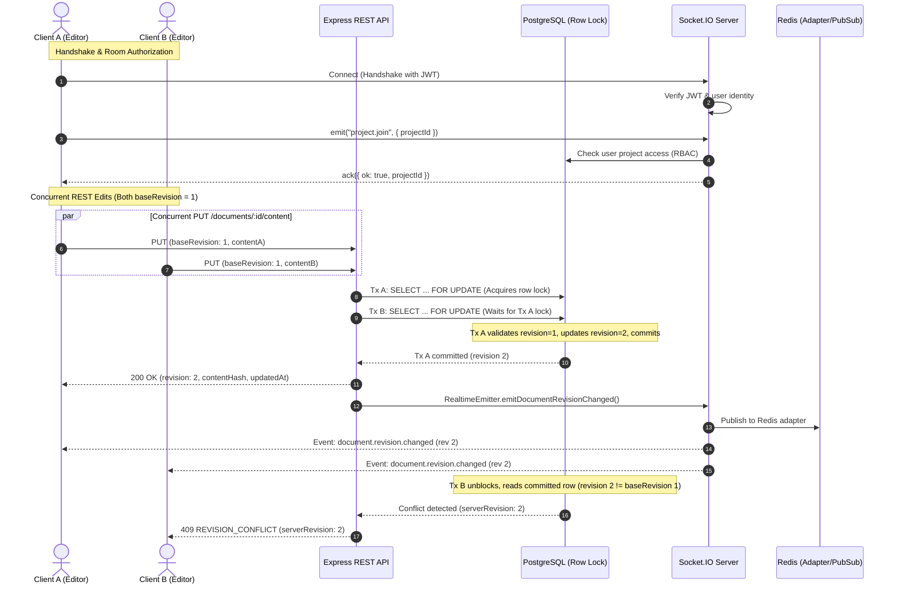

# Phase 07A Completion Report: Backend Revision Control & Realtime Synchronization

**Date:** 2026-11-20  
**Phase:** 07A  
**Status:** Completed & Verified  

---

## 1. Executive Summary

Phase 07A delivers the backend foundation for strict document revision control, atomic concurrency guarantees, authenticated Socket.IO infrastructure, Redis adapter integration, and realtime synchronization for Texly.

The backend acts as the single authoritative source of truth for all document content and revision states.

Key achievements:
- **Atomic Concurrency & Row-Level Locking:** Strengthened the document persistence pipeline (`PUT /projects/:projectId/documents/:documentId/content` and direct `PUT /documents/:documentId/content`) using PostgreSQL `SELECT ... FOR UPDATE` row locks within Prisma transactions. Verified that concurrent requests with identical `baseRevision` strictly yield exactly one successful revision increment (`200 OK`) and one conflict rejection (`409 REVISION_CONFLICT`).
- **Deterministic Revision Invariants:** Normalized line endings to LF (`\r\n` → `\n`), calculated SHA-256 content hashes, validated optional `clientHash` integrity (returning `422 HASH_MISMATCH` on tampering), and prevented partial updates upon transaction rollback.
- **Authenticated Socket.IO Infrastructure:** Handshake authentication middleware verifying asymmetric JWT access tokens with key rotation support (`kid`), rejecting unauthenticated sockets, and attaching verified user context to connections.
- **Authorized Project & Document Rooms:** Enforced role-based access control (RBAC) prior to room subscription. Outsiders and non-members are blocked from joining `project:{projectId}` or `document:{documentId}` rooms.
- **Authoritative Realtime Notification Events:** Lightweight notification-only event broadcasts:
  - `document.revision.changed`: Delivered to project and document rooms on REST content saves.
  - `file.tree.changed`: Delivered to project rooms on file creation, renaming, moving, deletion, and main document updates.
- **Reconnect Recovery via Project Synchronization:** Implemented `project.sync` Socket.IO request/response contract allowing clients to fetch authoritative file trees, document revisions, and active compilation states to detect missed events during disconnections without transferring raw document bodies.
- **Redis Multi-Node Reliability:** Configured `@socket.io/redis-adapter` for scalable multi-instance deployment with error isolation and graceful fallback.
- **Strict Scope Boundaries:** Mutations remain strictly REST-based; WebSocket connections are restricted to notifications and synchronization.

---

## 2. Architecture & Data Flow

---

## 3. Backend Modules Implemented & Modified

### 3.1 Document Concurrency & Persistence (`apps/server/src/modules/documents/`)
- `documents.repository.ts`:
  - Added `findProjectIdForDocument(documentId)` for resolving project context when endpoints are called directly.
  - Implemented PostgreSQL `SELECT ... FOR UPDATE` row-level locking within Prisma transactions to serialize concurrent saves on the same document row.
  - Enforced optimistic concurrency: rejects any request where `lockedDoc.revision !== baseRevision` with `409 REVISION_CONFLICT` and server metadata (`serverRevision`, `serverHash`, `updatedAt`, `updatedById`).
  - Added no-op detection: returns `unchanged: true` with existing revision when content hash is identical.
- `documents.service.ts`:
  - Exposed `findProjectIdForDocument`.
  - Normalizes CRLF to LF line endings.
  - Validates `clientHash` against calculated SHA-256 hash.
  - Emits `document.revision.changed` upon revision increments.
- `documents.controller.ts`:
  - Added resolution of `projectId` from `documentId` when route parameters omit `:projectId`.
- `documents.routes.ts`:
  - Mounted routes on both `/projects/:projectId/documents` and `/documents`.

### 3.2 Realtime Infrastructure (`apps/server/src/realtime/`)
- `socket-server.ts`:
  - Configured `@socket.io/redis-adapter` for multi-backend instance synchronization.
  - Implemented JWT authentication handshake extracting tokens from `auth.token`, `Authorization: Bearer <token>`, or `accessToken` cookie.
  - Validated incoming socket payloads with strict Zod schemas (`ProjectJoinEventSchema`, `ProjectLeaveEventSchema`, `DocumentJoinEventSchema`, `DocumentLeaveEventSchema`, `ProjectSyncRequestSchema`).
  - Enforced RBAC authorization via `DocumentsRepository.getProjectAccess()` before joining project or document rooms.
  - Handled `project.sync` requests, querying authoritative project file trees, document revision summaries, and active compilation statuses.
- `realtime-emitter.ts`:
  - Multi-room broadcast: `document.revision.changed` is emitted to both `project:${projectId}` and `document:${documentId}`.
  - Cross-node broadcast: publishes events to Redis `realtime:events` channel.

### 3.3 Shared Event Contracts (`packages/shared/src/events/`)
- `projects.ts`:
  - Added `ProjectSyncRequestSchema`, `ProjectSyncResponseSchema`, `ProjectSyncFileItemSchema`, `ProjectSyncDocumentItemSchema`.
  - Added `DocumentJoinEventSchema`, `DocumentLeaveEventSchema`, and `SocketErrorPayloadSchema`.
- `files.ts`:
  - Added `'set_main'` to `FileTreeOpSchema`.

---

## 4. Concurrency Guarantees & Integrity Analysis

| Threat / Race Condition | Mitigation | Verification |
| :--- | :--- | :--- |
| **Lost Update (Concurrent Writers)** | `SELECT ... FOR UPDATE` row lock in PostgreSQL serializes transactions. The second transaction unblocks only after the first commits, observes `revision = baseRevision + 1`, and throws 409. | Verified in `documents.integration.test.ts` via concurrent `Promise.all` requests. |
| **Partial Updates on Failure** | Full multi-statement PostgreSQL transactions (`tx.$transaction`) roll back content, hash, file size, and timestamp if any validation fails. | Verified: aborted transactions leave previous revision unchanged in DB. |
| **Unauthorized Room Eavesdropping** | Handshake rejects missing/invalid JWTs. `project.join` and `document.join` verify database membership before adding sockets to rooms. | Verified in `realtime.integration.test.ts`: outsider sockets receive `FORBIDDEN` error. |
| **Cross-Project Document Access** | Access queries scope document lookups by `projectId` and verify project membership. Mismatched project IDs return 404. | Verified: cross-project PUT returns 404. |
| **Missed Events After Reconnect** | Clients call `project.sync` to retrieve authoritative revision numbers and hashes across all project files without pulling entire file contents. | Verified in `realtime.integration.test.ts`: sync response returns current server state. |

---

## 5. Verification & Test Results

### 5.1 Test Execution Summary

- **`documents.integration.test.ts` (11 tests, 100% passing)**:
  - Validates `GET /main` document retrieval and RBAC access.
  - Validates `PUT /content` revision increments, LF normalization, and SHA-256 hashing.
  - Validates no-op saves returning `unchanged: true`.
  - Validates stale `baseRevision` rejection with 409 `REVISION_CONFLICT`.
  - **Atomic Concurrency Test**: Two concurrent updates with the same `baseRevision` yield exactly one 200 winner and one 409 conflict.
  - Validates direct `PUT /api/v1/documents/:documentId/content` route.
  - Validates rejection of cross-project document access (404).
  - Validates `clientHash` mismatch rejection (422 `HASH_MISMATCH`).
  - Validates `VIEWER` role rejection (403 `FORBIDDEN`).

- **`realtime.integration.test.ts` (10 tests, 100% passing)**:
  - Rejection of unauthenticated socket connections.
  - Rejection of invalid tokens.
  - Connection success with valid JWT.
  - Rejection of unauthorized project room join.
  - Rejection of invalid socket payload schemas.
  - Authorized project room join and acknowledgement.
  - Authorized document room join and leave.
  - `document.revision.changed` delivery to subscribers on REST PUT.
  - `file.tree.changed` delivery to subscribers on REST file creation.
  - `project.sync` returning authoritative file tree and document revisions.

- **Full Workspace Test Health**:
  - `@texly/server`: 10 test files (107 tests), 100% passing.
  - `@texly/web`: 20 test files (108 tests), 100% passing.
  - `@texly/shared`: 6 test files (40 tests), 100% passing.
  - Architectural boundaries: 0 violations (`depcruise`).
  - TypeScript: strict typecheck clean across all packages.

---

## 6. Known Limitations & Remaining Work for Phase 07B

- **Scope Adherence:** As specified in Phase 07A scope boundaries, client-side autosave timers, IndexedDB draft storage, conflict resolution dialogs, and frontend realtime hooks were deferred to Phase 07B.
- **Remaining for Phase 07B:**
  - Frontend integration of `document.revision.changed` and `file.tree.changed` via TanStack Query cache invalidation and Zustand sync.
  - Client-side conflict detection and merge resolution modal for stale drafts.
  - Reconnection state machine on the frontend leveraging `project.sync`.
