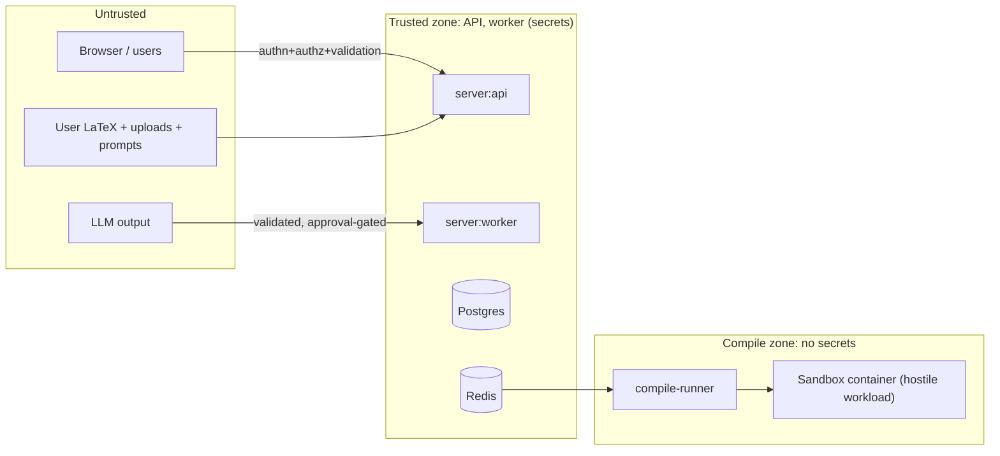

# SECURITY.md — Security Architecture and Threat Model

**Scope:** web application, API, workers, compile sandbox, storage, AI integration, CI/CD and infrastructure.
**Principle:** assume user-supplied LaTeX, filenames, uploads and prompts are hostile; assume any single control can fail and add a second layer.

---

## 1. Assets and trust boundaries

| Asset | Sensitivity | Where |
|---|---|---|
| User documents (unpublished research, resumes with PII) | High | Postgres, R2 |
| Credentials: passwords, refresh tokens | Critical | Postgres (hashed) |
| Platform secrets: DB URL, R2 keys, LLM API keys, JWT keys | Critical | Secrets Manager → API/worker only |
| Compile infrastructure integrity | High | EC2 compile nodes |
| LLM budget | Medium–High | Provider accounts |
| Availability | Medium–High | all |

Trust boundaries: Internet↔API; API↔compile zone (queue only, signed/validated payloads); runner↔sandbox (hard boundary); app↔LLM providers (egress only).

## 2. Threat model (STRIDE-oriented, prioritized)

| # | Threat | Category | Likelihood × Impact | Primary mitigations (section) |
|---|---|---|---|---|
| T1 | Malicious LaTeX executes commands on host (`\write18`, Lua `os.execute`) | EoP / RCE | High × Critical | §3.1, §3.2 |
| T2 | LaTeX reads host files (`\input{/etc/passwd}`, `\openin`) and exfiltrates via PDF/log | Info disclosure | High × High | §3.1 (`openin_any=p`, read-only FS, no host mounts, no secrets on node) |
| T3 | Container escape → compile node compromise → lateral movement | EoP | Low × Critical | §3.3 (unprivileged, seccomp, no caps, gVisor option, isolated subnet, no creds on node) |
| T4 | Resource exhaustion (infinite loops, memory bombs, disk fill, fork bombs, huge images) | DoS | High × Medium | §3.4 |
| T5 | Malicious output collection (symlink in `/work/out` → host file uploaded) | Info disclosure | Medium × High | §3.5 |
| T6 | Cross-user data access (IDOR) | Info disclosure | Medium × Critical | §4.3 |
| T7 | Account takeover (credential stuffing, token theft, refresh reuse) | Spoofing | High × High | §4.1, §4.2 |
| T8 | XSS via uploaded SVG/HTML/PDF or filenames | Tampering/EoP | Medium × High | §5.3 |
| T9 | Stale/poisoned AI proposal overwrites document | Tampering | Medium × High | AI doc §7 (revision/hash guards, approval) |
| T10 | Prompt injection from document content steers LLM | Tampering | High × Low–Medium (no tools, approval gate) | §6 |
| T11 | LLM cost abuse | DoS (financial) | High × Medium | §6.3 |
| T12 | Supply-chain compromise (npm, base images, TeX packages) | Tampering | Medium × High | §8 |
| T13 | Secret leakage (logs, env, repos, presigned URLs) | Info disclosure | Medium × High | §7 |
| T14 | CSRF / CORS misconfiguration | Tampering | Medium × Medium | §4.2 |
| T15 | Zip-slip / archive bombs on import | Tampering/DoS | Medium × High | §5.2 |
| T16 | Abuse of platform for crypto mining / spam | Abuse | Medium × Medium | §3.4, §9 |
| T17 | Data loss via bug/ransomware/accidental deletion | Availability | Medium × High | Storage doc §9–10 |
| T18 | Presigned URL leakage or overly long TTL | Info disclosure | Medium × Medium | Storage doc §4 |

## 3. Secure LaTeX compilation sandbox

Rule zero: **user LaTeX never runs in the API/worker process, and the compile host has nothing worth stealing.** Defense in depth, outermost to innermost:

### 3.1 TeX-level restrictions (stops T1, T2 at the language layer)
- `-no-shell-escape` on every engine invocation **and** `shell_escape = f` in the custom `texmf.cnf` (TeX Live default is *restricted* shell escape, which still permits a small allowlist of programs; we disable it completely).
- `openin_any = p` and `openout_any = p` (paranoid): blocks absolute paths, parent-directory traversal and dotfiles for reading/writing.
- LuaLaTeX: `--safer` (disables unsafe Lua library functions) and `--nosocket`.
- `latexmk -norc`: no system/user/**project** `latexmkrc` is evaluated (it is Perl).
- No `TEXINPUTS`/`TEXMFCNF` influence from users; environment is set by the runner.
- Memory-related `texmf.cnf` caps (`main_memory`, `hash_extra`, etc.) so runaway macros abort before the OOM killer.
- Defense in depth at AI layer: validator V11 rejects AI edits that introduce dangerous primitives.
> TeX-level controls are *not* relied upon as the boundary — they reduce blast radius. The container is the boundary.

### 3.2 Process and filesystem isolation (T1, T2, T3)
Per-job, freshly created container with the flags in `COMPILATION_ENGINE.md` §4.2. Key properties:

| Control | Effect |
|---|---|
| `--network none` | No outbound/inbound network, no DNS, no metadata service (`169.254.169.254`) access |
| `--read-only` rootfs + tmpfs `/tmp` (`noexec,nosuid`) | Cannot persist or execute dropped binaries; only `/work` is writable |
| `--cap-drop ALL`, `no-new-privileges`, non-root uid 10001 | No privilege escalation path via setuid binaries or capabilities |
| Default seccomp profile (baseline), tightened custom profile (hardening phase) | Restrict dangerous syscalls (e.g., `mount`, `ptrace`, `keyctl`, `bpf`) |
| No host mounts except the per-job `/work` dir and read-only `texmf.cnf` | Nothing else on the host is visible |
| No Docker socket in sandbox; no secrets in env | Nothing to steal |
| Masked `/proc` paths, read-only `/sys` (Docker defaults) | Limits kernel info disclosure |
| **gVisor (`runsc`) or Firecracker microVM** (hardening phase, ADR-014) | Adds a user-space kernel boundary against kernel 0-days — recommended before opening sign-ups widely |

### 3.3 Host and network isolation (T3)
- Compile nodes run in a **dedicated subnet/security group**: inbound none (SSM Session Manager for admin, no SSH), outbound only to Redis (6379/TLS) and HTTPS (R2). No route to RDS or internal admin services.
- **Compile runner credentials:** Redis auth only. **No** R2 keys, DB creds, LLM keys, or AWS permissions beyond CloudWatch metrics/logs (instance role minimal). IMDSv2 required with hop limit 1 so even a compromised *container* (network none anyway) cannot reach instance credentials.
- Docker daemon: runner talks to the **local** daemon over the Unix socket; the runner is the only process with access. If rootless Docker is feasible on the chosen AMI, use it (ADR-014 evaluates rootless vs gVisor). The runner constructs container configs **only from a fixed template**; job data can influence only validated fields (paths, engine enum, limits ≤ plan caps).
- Nodes are **cattle**: ASG instance refresh weekly; compromised-node response = terminate instance (nothing persistent).
- Separate AWS account or at minimum separate VPC for compile fleet (recommended in production).

### 3.4 Resource exhaustion controls (T4, T16)
CPU (`--cpus`), memory (`--memory` = swap limit), PIDs (`--pids-limit`), file size (`ulimit -f`), open files, wall-clock timeout (in-container `timeout -s KILL` + host deadline + `docker kill`), per-job work dir bound (inputs capped; XFS project quota in hardening), output caps (PDF/log/file-count), log truncation, per-user concurrency and rate limits, per-plan monthly compile-seconds, queue priority by plan, automated detection of users with repeated timeouts (cool-down).
**Image bombs:** dimension/megapixel limit at upload (header read), plus memory cap in sandbox.

### 3.5 Output and ingestion hygiene (T5)
- Runner collects only **regular files** under `/work/out`/`aux` via `lstat` + `O_NOFOLLOW`; symlinks, devices, FIFOs ignored; size/count caps; only known output names uploaded.
- The PDF and log are treated as **untrusted bytes**: never parsed by API/worker native code except the bounded TypeScript log parser; the API never opens PDFs (PDF.js in the user's browser renders them — see §5.3 for browser-side containment).
- Runner uploads via presigned PUT with `Content-Type` fixed by the runner; the ingest worker `HEAD`s results and enforces size ceilings again.

### 3.6 Required security test suite
Runs in CI on every sandbox/image change and nightly — full list in `COMPILATION_ENGINE.md` §13 and `TESTING_STRATEGY.md` §8. **A failing test blocks deployment of the compile fleet.**

## 4. Application security

### 4.1 Credentials and sessions (T7)
- Passwords: **argon2id** (memory ≥ 19 MiB, t≥2, p=1 minimum per current OWASP guidance; tune on target hardware, re-hash on login if parameters change). Min length 10; check against a breached-password list (k-anonymity API or local list); no composition rules.
- Access token: short-lived (15 min) JWT with `sub`, `sid`, `iat`, `exp`, `iss`, `aud`; asymmetric signing (EdDSA/RS256) with key rotation (`kid`); kept **in memory only** (not localStorage) to limit XSS theft.
- Refresh token: opaque, 256-bit random, stored **hashed**, rotating on use with **reuse detection** (family revocation), `httpOnly; Secure; SameSite=Lax`, path-scoped to `/api/v1/auth`.
- Brute-force controls: per-IP and per-account limits with progressive delay; generic error messages; optional CAPTCHA after repeated failures (post-MVP).
- Email verification required before sharing/inviting and before high AI quotas; password-reset tokens single-use, 30 min, hashed at rest; all sessions revoked on reset/password change.
- WebSocket: token verified at handshake; connections re-validated on token refresh; max connections per user.

### 4.2 Transport and browser protections (T14)
- TLS 1.2+ everywhere (ALB, RDS `require`, Redis TLS), HSTS (preload after stabilization).
- **CORS:** allowlist of exact web origins, `credentials: true` only on `/auth/refresh`; no wildcard.
- **CSRF:** mutation endpoints use Bearer tokens (not ambient cookies) → inherently CSRF-resistant; the only cookie-authenticated endpoint (`/auth/refresh`, `/auth/logout`) checks `Origin`/`Sec-Fetch-Site` and uses `SameSite=Lax`.
- Helmet defaults; `Cache-Control: no-store` on authenticated JSON.
- **CSP (web):** `default-src 'self'; script-src 'self' 'nonce-…'; worker-src 'self' blob:; connect-src 'self' <api> <ws> <files-domain>; img-src 'self' data: blob: <files-domain>; frame-ancestors 'none'; object-src 'none'; base-uri 'none'`. PDF.js worker loaded from same origin.
- `Referrer-Policy: strict-origin-when-cross-origin`, `Permissions-Policy` minimal.

### 4.3 Authorization (T6)
- Central `authorize(minRole)` middleware + service-level scoping. **Every query for a child resource includes `projectId`** (e.g., `WHERE id = $doc AND project_id = $project`), preventing IDOR through guessed IDs.
- UUIDv7 IDs are not secrets; authorization never relies on ID unguessability.
- Non-visible resources return `404`, not `403`.
- Tests: an authorization matrix test generated from route metadata asserts each route for each role and for a user from another project.
- Admin tooling (if any) is a separate role, separate audience, and fully audit-logged.

### 4.4 Input validation and injection
- Zod validation on every input; strict (no unknown keys); size limits.
- Prisma parameterized queries; **no string-built SQL**; raw SQL only in reviewed migrations / `$queryRaw` with tagged templates.
- File names/paths normalized and validated (no traversal, reserved names, control chars); object keys contain no user strings.
- Output encoding: React escapes by default; no `dangerouslySetInnerHTML` except through a sanitizer allowlist (documented exceptions).
- Rate limiting and body-size limits at the edge (ALB/WAF) and app.
- **WAF** (AWS WAF managed rule sets) on ALB from staging onward.

## 5. Data and storage security

### 5.1 Encryption and access
- At rest: RDS storage encryption (KMS), ElastiCache encryption, R2 server-side encryption (default), encrypted EBS on compile nodes. In transit: TLS.
- Principle of least privilege: separate R2 tokens (server vs backup), compile nodes none; IAM roles per service; DB roles: app role (DML only), migration role (DDL), read-only analytics role.
- Presigned URLs: short TTL, scoped to a single key and method; never logged; never stored.

### 5.2 Uploads and archives (T15)
Extension allowlist + server-side magic-byte sniffing; image header dimension caps; size/quota enforcement; no server-side decoding in MVP; antivirus hook (hardening). Archive import (post-MVP): reject absolute paths, `..`, symlinks/hardlinks, device files; cap total uncompressed size, file count, compression ratio; extract in the sandbox pattern, not in the API process.

### 5.3 Serving user content safely (T8)
- User files are served from a **separate cookie-less domain** with `Content-Security-Policy: sandbox`, `X-Content-Type-Options: nosniff`, correct `Content-Type` (server-determined), and `Content-Disposition: attachment` for everything except PDFs and sniff-verified raster images.
- **SVG is never rendered inline**; HTML is never accepted as an asset.
- PDFs render in PDF.js (canvas + text layer) — **not** by embedding the browser's native PDF plugin of an untrusted origin inside the app origin; PDF JavaScript is not executed (PDF.js `isEvalSupported: false`, scripting disabled).
- File and project names are rendered as text only.

### 5.4 Privacy and retention
- Minimal PII (email, name). Document content, prompts and LLM outputs are **never logged**; logs carry IDs and sizes only.
- Account deletion: soft delete → purge job removes content and R2 objects within 30 days; backups age out per retention.
- LLM data handling: use provider API tiers/settings that do not train on API data (verify each provider's current policy and document it in the privacy notice); allow users to see which provider processed a request (proposal metadata).
- Data residency: choose AWS region (e.g., `ap-south-1` for India-centric users) and R2 location hint in `DEPLOYMENT.md`; disclose provider locations.

## 6. AI-specific security (T9–T11)

### 6.1 The approval gate is the primary control
The AI has **no tools, no network access and no write path**. Its only output is JSON validated against a schema, applied server-side to an immutable base, and shown to the user. The only code path that persists AI output is `accept`, requiring an authenticated EDITOR action and a matching revision/hash.

### 6.2 Prompt injection / data exfiltration
- Document, bibliography and diagnostics content is embedded as **delimited data** with an explicit instruction hierarchy in the system prompt.
- Because the model cannot call tools or fetch URLs, injection can at worst produce a bad *proposal*, which the user sees as a diff. Validators (V1–V12) flag dangerous primitives, mass deletions, out-of-scope edits.
- Cross-tenant isolation: each request contains only the caller's project data; no shared conversation memory across users/projects; provider-side caches keyed by content (no cross-account sharing assumed).
- LLM output is never rendered as HTML (assistant summary is plain text/Markdown with sanitization).

### 6.3 Abuse and cost controls (T11)
Per-user and per-workspace rate limits, concurrent generation = 1, daily and monthly token budgets by plan, max input/output tokens per call, circuit breaker per provider, anomaly alerts on spend/hour, kill switch (feature flag) to disable AI globally or per provider.

### 6.4 Provider keys
Held only by `server:worker` (and API for model listing, if needed); injected from Secrets Manager; rotated quarterly or on suspicion; per-environment keys with provider-side spending limits.

## 7. Secrets and configuration management (T13)
- No secrets in git (pre-commit + CI secret scanning, e.g., gitleaks); `.env.example` has placeholders only.
- Runtime: AWS Secrets Manager / SSM Parameter Store injected into ECS task env; local `.env` (gitignored).
- Log redaction list: `authorization`, `cookie`, `set-cookie`, `password`, `token`, `x-amz-signature`, presigned URL query strings, prompt/content fields.
- Rotation runbook: JWT keys (dual-key window), DB password, R2 tokens, LLM keys.
- Separate secrets per environment; production access via break-glass roles with MFA and audit.

## 8. Supply chain and CI/CD security (T12)
- Lockfile (`pnpm-lock.yaml`) committed; `pnpm install --frozen-lockfile`; Dependabot/Renovate with grouped updates; `pnpm audit` and `osv-scanner` in CI.
- Pin GitHub Actions by commit SHA; least-privilege `GITHUB_TOKEN`; OIDC federation to AWS (no long-lived AWS keys).
- Container hygiene: minimal base images, non-root users, Trivy scan (fail on critical/high with fix available), SBOM generation, image signing (cosign) and verification at deploy (hardening).
- TeX Live image built from official sources at a **pinned release**, checksum verified; rebuilt on schedule; compile fleet pulls images by digest.
- Prisma and other native/postinstall scripts reviewed; `ignore-scripts` where feasible.
- Branch protection: required reviews, status checks, signed commits optional; CODEOWNERS for `apps/compile-runner`, `docker/texlive`, `infra/`, `packages/db`.

## 9. Monitoring, detection and response
- **Audit log:** auth events, member changes, project deletion, AI accept/reject, restore, admin actions.
- **Security metrics/alerts:** auth failure spikes; refresh-reuse detections; compile timeouts/OOM per user; sandbox test failures; container count anomalies; unusual outbound from compile subnet (VPC Flow Logs); LLM spend spikes; 5xx rates; R2 4xx anomalies.
- **Incident response:** runbooks for (a) suspected sandbox escape (isolate/terminate nodes, rotate Redis creds, review flow logs, notify users per law), (b) credential leak (rotate, revoke sessions), (c) data exposure bug (disable endpoint via flag, forensics from logs, notification), (d) provider key leak (rotate, spend review).
- **Abuse handling:** account suspension flag (`disabledAt`) checked at auth and on WS; compile bans; takedown procedure for illegal content.
- Vulnerability disclosure: `SECURITY.txt` + contact address; triage SLA.

## 10. Compliance posture (informational; legal review required)
Design supports GDPR-style needs: export (project zip + account data), deletion, minimization, processor list (AWS, Cloudflare, LLM providers), breach notification procedure. India's DPDP Act considerations apply if serving Indian users — confirm with counsel. No special regulated data (health/payment) is stored in MVP; billing (post-MVP) via a PCI-compliant processor (card data never touches our systems).

## 11. Security acceptance criteria (release gates)
- [ ] Compile sandbox security suite passes (all cases) on the production image digest.
- [ ] Authorization matrix tests pass; IDOR tests for every resource type.
- [ ] No high/critical vulnerabilities with available fixes in dependencies/images.
- [ ] Secrets scan clean; no secrets in images or logs (log sampling review).
- [ ] CSP and security headers verified (automated test + manual review).
- [ ] Rate limits verified under load test; compile and AI abuse scenarios tested.
- [ ] Pen-test/self-assessment of sandbox and auth completed before public signup; gVisor/rootless decision (ADR-014) implemented or risk accepted in writing.
- [ ] Backup restore drill completed; incident runbooks reviewed.
