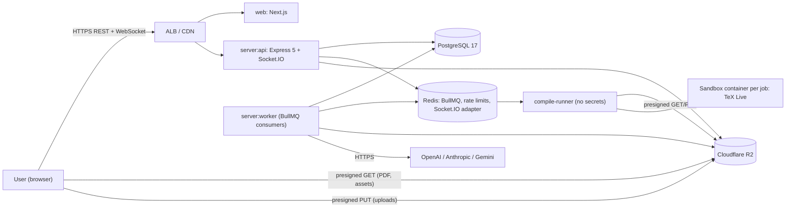
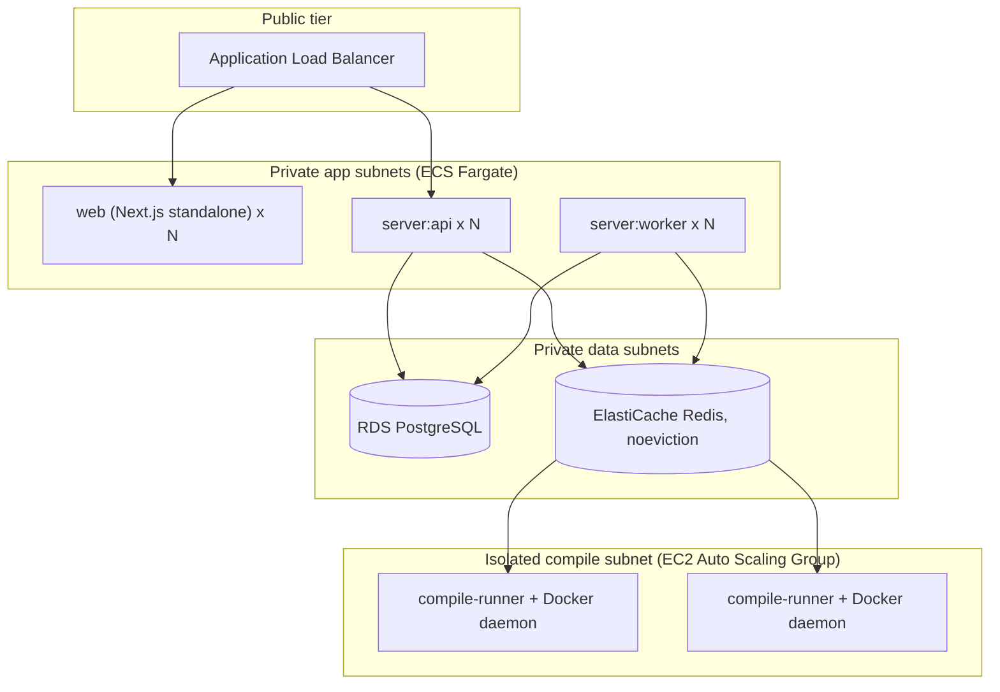

# SYSTEM_ARCHITECTURE.md

**Product (working name):** Texly — a web-based LaTeX editor with a user-controlled AI modification workflow
**Status:** Planning / architecture phase. No application code exists yet.
**Last reviewed:** 2026-11-09
**Companion docs:** `PRD.md`, `DATABASE_DESIGN.md`, `API_SPECIFICATION.md`, `AI_ARCHITECTURE.md`, `COMPILATION_ENGINE.md`, `STORAGE_ARCHITECTURE.md`, `SECURITY.md`, `DEPLOYMENT.md`, `DECISIONS.md`

---

## 1. Purpose and scope

This document defines the overall system: components, boundaries, data flows, realtime design, backend module layout, cross-cutting concerns, non-functional targets and failure strategy. Details for individual subsystems live in the companion documents; this file is the map that keeps them consistent.

## 2. Architectural principles

1. **Modular monolith + isolated compile runners.** One backend codebase (`apps/server`) with multiple entrypoints (API, background worker). The only separately deployed, independently scaled component with a different trust level is the **compile runner**. No other microservices.
2. **PostgreSQL is the source of truth for text.** `.tex`/`.bib`/other text sources, revisions, versions and AI proposals live in PostgreSQL. R2 holds binaries and derived artifacts.
3. **The user owns the document.** AI never writes to a document. Every AI change is a *proposal* that is committed only by an explicit Accept, as an atomic, revision-checked transaction.
4. **Untrusted input is executed only in a sandbox.** User LaTeX never runs in the API process, the general worker or any process holding secrets.
5. **Compile runners hold no secrets.** They receive presigned URLs per job and have no DB, R2 or LLM credentials.
6. **Optimistic concurrency everywhere.** Every document write carries `baseRevision`; the server rejects stale writes with `409`.
7. **Contract-first.** Zod schemas in `packages/shared` are the single source for REST payloads, WebSocket events, queue payloads and AI edit operations.
8. **Boring technology.** No technology is added without an ADR (`DECISIONS.md`).

## 3. Technology stack (verified against public release information, Nov 2026)

| Layer | Choice | Notes |
|---|---|---|
| Runtime | Node.js **24 LTS** | Prisma 7 supports Node 20.19+/22.12+/24+. |
| Language | TypeScript 5.9+ (strict) | Required by Prisma 8 too, so future upgrade is unblocked. |
| Frontend | Next.js **16.x**, React, Tailwind CSS, shadcn/ui | Next.js 16 line is current (16.4.x at time of writing). Pin exact version at scaffold time. |
| Editor | CodeMirror 6 (`@codemirror/state`, `view`, `commands`, `language`, `autocomplete`, `search`, `lint`, `merge`, `legacy-modes`) | `@codemirror/merge` provides the unified diff view used for AI review. |
| PDF | `pdfjs-dist` (PDF.js) | Rendered in a web worker; custom React viewer (not the stock viewer). |
| Backend | Express **5**, TypeScript, REST + Socket.IO | Socket.IO chosen over raw `ws` for rooms, reconnection, Redis adapter. |
| DB | PostgreSQL **17**, Prisma ORM **7.x** | Prisma 8 is at RC as of Oct 2026 — stay on 7.x until 8 is GA and one patch release old. Do not run unpinned `npm install prisma` (it resolves to the RC). |
| Queue | Redis 7.x (or Valkey) + BullMQ | Redis must run with `maxmemory-policy noeviction`. |
| Storage | Cloudflare R2 via S3-compatible API (`@aws-sdk/client-s3`, `@aws-sdk/s3-request-presigner`) | |
| LaTeX | TeX Live (pinned release), latexmk, pdfLaTeX / XeLaTeX / LuaLaTeX, BibTeX, Biber | In a Docker image used only by compile runners. |
| LLM | OpenAI, Anthropic, Google Gemini via official SDKs behind `LLMProvider` interface | Model IDs are config, not code. |
| Testing | Vitest, Supertest, Playwright, Testcontainers, MinIO (local R2 stand-in) | |
| Infra | Docker, Docker Compose (local), AWS (ECS Fargate + EC2 ASG for compile), Terraform, GitHub Actions | |

Additional libraries introduced (each justified in `DECISIONS.md`): pnpm + Turborepo, Zod, TanStack Query, Zustand, `react-resizable-panels` (via shadcn Resizable), argon2, pino, `rate-limiter-flexible`, `dockerode`, `diff` (jsdiff), Sentry, k6.

## 4. System context



## 5. Container view and process topology



| Process | Image target | Scales on | Holds secrets | Talks to |
|---|---|---|---|---|
| `web` | `web` | RPS / CPU | none (public config only) | API |
| `server:api` | `server` (cmd `api`) | RPS, WS connections | DB, Redis, R2, JWT keys | PG, Redis, R2 |
| `server:worker` | `server` (cmd `worker`) | queue depth | DB, Redis, R2, LLM keys | PG, Redis, R2, LLM APIs |
| `compile-runner` | `compile-runner` | `compile` queue depth + wait time | **Redis only** | Redis, R2 (presigned), local Docker |
| sandbox | `texly/texlive:<year>` | one per job | none | none (`--network none`) |

`server:api` and `server:worker` are the same codebase and image with different entrypoints; they can be co-located on a single host in early environments.

## 6. Repository structure (monorepo, pnpm + Turborepo)

```
texly/
├─ apps/
│  ├─ web/                  # Next.js 16 UI (client-heavy; no business logic in Next route handlers)
│  ├─ server/               # Express API + Socket.IO + BullMQ workers (modular monolith)
│  └─ compile-runner/       # Minimal BullMQ consumer + Docker orchestration. NO DB/R2 credentials.
├─ packages/
│  ├─ shared/               # Zod schemas, DTO types, error codes, WS event catalog, queue payload schemas
│  ├─ db/                   # Prisma schema, migrations, client factory, raw-SQL migrations
│  ├─ llm/                  # LLMProvider interface, adapters, prompt builder, edit-op engine
│  ├─ latex/                # Pure TS: log parser, symbol/outline parser, structural validators, command catalog
│  └─ config/               # tsconfig, eslint, prettier presets
├─ docker/
│  ├─ texlive/              # Dockerfile for sandbox image + texmf.cnf
│  ├─ compose.dev.yml
│  └─ compile-runner.Dockerfile, server.Dockerfile, web.Dockerfile
├─ infra/terraform/         # AWS infrastructure
├─ docs/                    # these documents
└─ .github/workflows/
```

**Dependency rules (enforced by `dependency-cruiser` in CI):**

- `apps/compile-runner` may import only `packages/shared` and `packages/latex`. It must never import `packages/db`, AWS SDK for R2 credentials, or `packages/llm`.
- `packages/*` never import from `apps/*`.
- `apps/web` imports only `packages/shared` (types/schemas) and `packages/latex` (client-side parsing helpers).
- `packages/latex` is pure (no I/O, no Node-only APIs) so it runs in browser and worker.

## 7. Backend module layout (`apps/server/src`)

```
src/
├─ entrypoints/
│  ├─ api.ts                # HTTP + Socket.IO bootstrap
│  └─ worker.ts             # BullMQ workers bootstrap
├─ config/                  # env parsing (Zod), feature flags, plan limits, model catalog
├─ http/
│  ├─ app.ts                # Express app factory
│  ├─ middleware/           # requestId, auth, authorize, rateLimit, validate, errorHandler, cors, helmet
│  └─ routes.ts             # mounts module routers under /api/v1
├─ modules/                 # vertical feature modules; each has the same internal layers
│  ├─ auth/
│  ├─ users/
│  ├─ workspaces/
│  ├─ projects/             # projects, members, invites
│  ├─ files/                # file tree, assets (upload workflow), downloads
│  ├─ documents/            # content, autosave, symbols index
│  ├─ versions/             # document versions, project snapshots, diff/compare
│  ├─ compilation/          # compile requests, results ingestion, synctex, diagnostics
│  ├─ ai/                   # conversations, messages, proposals, accept/reject, usage
│  ├─ comments/             # post-MVP
│  └─ billing/              # post-MVP
│     each module: <name>.routes.ts, .controller.ts, .service.ts, .repository.ts, .validators.ts (re-exports shared Zod), .types.ts, __tests__/
├─ infrastructure/
│  ├─ db/                   # Prisma client singleton, transaction helper, advisory-lock helper
│  ├─ storage/              # R2 client, key builder, presign, multipart, deletion outbox
│  ├─ queue/                # BullMQ queue/worker factories, typed job definitions
│  ├─ realtime/             # Socket.IO server, auth handshake, room helpers, event emitters
│  ├─ llm/                  # wiring of packages/llm to config + usage recording
│  ├─ email/                # transactional email adapter
│  └─ cache/                # Redis client, rate limiter stores
├─ workers/                 # BullMQ processors: aiGenerate, compileResults, storageGc, reconcile, exportZip, retention
├─ shared/                  # errors (AppError), logger, clock, id/hash helpers, pagination
└─ tests/                   # cross-module integration + e2e API tests, fixtures, testcontainers setup
```

### Layer responsibilities

| Layer | Responsibility | Must not |
|---|---|---|
| Route | Bind URL + middleware chain + controller | Contain logic |
| Controller | Parse validated request, call one service method, shape response | Touch Prisma or Redis |
| Service | Business rules, transactions, authorization checks that depend on data, emits domain events | Know about Express `req/res` |
| Repository | All Prisma queries for the module's tables | Contain business rules; call other modules' repositories |
| Infrastructure | External systems (R2, Redis, LLM, email) behind interfaces | Contain business rules |
| Worker processor | Consume job, call service methods, ensure idempotency | Duplicate service logic |

**Cross-module rule:** a module calls another module only through its **service** (exported interface), never its repository or Prisma tables directly.

## 8. Key data flows (summary; full detail in linked docs)

### 8.1 Editing and autosave
Client edits → CodeMirror `updateListener` → debounced (1.5 s, max-wait 10 s) → `PUT /documents/:id/content {baseRevision, content}` → server transaction `UPDATE documents SET content, revision = revision + 1 WHERE id = ? AND revision = ?` → `200 {revision, contentHash}`; zero rows → `409 REVISION_CONFLICT`. Unsaved text is mirrored to IndexedDB for crash recovery. Details: `DATABASE_DESIGN.md` §8.

### 8.2 Compile
`POST /projects/:id/compilations` → DB row `QUEUED` + immutable input snapshot (text bundle in R2) → BullMQ `compile` job → compile-runner → sandbox container → artifacts via presigned PUT → result message on `compile-results` queue → `server:worker` persists and emits `compilation.finished` over WebSocket → client fetches presigned PDF URL. Details: `COMPILATION_ENGINE.md`.

### 8.3 AI proposal
`POST /ai/conversations/:id/messages {mode:"edit"}` → `AIProposal(QUEUED, baseRevision, baseHash)` → BullMQ `ai-generate` → LLM returns structured edit operations → server applies them to the base text, validates LaTeX structure, computes diff → `PENDING` → WS `ai.proposal.updated` → editor enters **review mode** (unified merge view; document not persisted) → Accept (`POST …/accept` atomic commit) or Reject. Details: `AI_ARCHITECTURE.md`.

## 9. Realtime design (Socket.IO)

- **Transport:** Socket.IO over the same ALB; sticky sessions not required because of the Redis adapter.
- **Auth:** access token passed in handshake `auth.token`; verified on connect; re-verified on token refresh via `auth:refresh` client event. Connection joins `user:{userId}`. Client explicitly joins `project:{projectId}` (`project.join`), which the server authorizes by project role.
- **Rooms:** `user:{id}`, `project:{id}`, `document:{id}` (presence/revision notices).
- **Delivery semantics:** events are *hints*, not state. Every event carries the authoritative identifier; clients refetch via REST when they detect a gap. On (re)connect the client calls `project.join` with `lastSeenEventId`; server replies `project.sync` with current statuses of active compilations and pending proposals (so a refresh mid-AI-generation restores UI).

| Event (server → client) | Payload (summary) | Replaces polling of |
|---|---|---|
| `compilation.queued / started / finished` | `{compilationId, status, durationMs?, errorCount?, warningCount?}` | `GET /compilations/:id` |
| `ai.proposal.updated` | `{proposalId, status, summary?, diffStats?, errorCode?}` | `GET /ai/proposals/:id` |
| `ai.message.delta` (post-MVP streaming for `mode:"ask"`) | `{messageId, delta}` | — |
| `document.revision.changed` | `{documentId, revision, byUserId}` | stale detection |
| `file.tree.changed` | `{projectId, op, fileId}` | `GET /files` |
| `presence.updated` (post-MVP) | `{documentId, users[]}` | — |

Client → server events: `project.join`, `project.leave`, `document.focus`, `auth:refresh`. **All mutations go through REST**; WebSocket is notification-only (simplifies validation, auditing, rate limiting, and retries).

## 10. Cross-cutting concerns

### 10.1 Authentication and sessions
- Email + password (argon2id). Access token: JWT (EdDSA or RS256), 15 min, held in memory. Refresh token: opaque 256-bit random, stored hashed in `sessions`, `httpOnly; Secure; SameSite=Lax; Path=/api/v1/auth`, 30 days, **rotated on every use** with reuse detection (reuse of a rotated token revokes the whole `familyId`).
- Web and API are same-site (`app.example.com` / `api.example.com`), so `SameSite=Lax` cookies work; refresh endpoint additionally checks `Origin`.
- OAuth providers (Google/GitHub) are post-MVP.

### 10.2 Authorization (RBAC)

| Capability | Owner | Editor | Commenter | Viewer |
|---|---|---|---|---|
| View files, PDF, versions | ✔ | ✔ | ✔ | ✔ |
| Edit documents, manage files, upload | ✔ | ✔ | ✖ | ✖ |
| Start compilation | ✔ | ✔ | ✖ | ✖ |
| Create / accept / reject AI proposals | ✔ | ✔ | ✖ | ✖ |
| Comment | ✔ | ✔ | ✔ | ✖ |
| Restore versions | ✔ | ✔ | ✖ | ✖ |
| Change project settings (engine, main file) | ✔ | ✔ | ✖ | ✖ |
| Manage members, delete project | ✔ | ✖ | ✖ | ✖ |

Enforcement: `authorize(minRole)` middleware resolves `(userId, projectId)` → role once per request (cached 30 s in Redis, invalidated on member change). Services re-check object ownership by joining through `projectId` — **never trust an ID from the URL without scoping it to the project**.

### 10.3 API conventions (summary; full in `API_SPECIFICATION.md`)
Base path `/api/v1`. Success envelope `{ "data": …, "meta": … }`. Error envelope `{ "error": { "code", "message", "details", "requestId" } }`. Cursor pagination. `Idempotency-Key` header supported on `POST` compile and `POST` AI message (Redis, 24 h).

### 10.4 Configuration
Single typed config object built from env via Zod at boot; the process **fails fast** on missing/invalid configuration. No `process.env` access outside `config/`.

### 10.5 Logging, tracing, metrics
pino JSON logs with `requestId`, `userId`, `projectId`, `jobId`; Sentry for errors; Prometheus-format metrics (`prom-client`) scraped by CloudWatch agent / Grafana Agent; OpenTelemetry tracing added in hardening phase. PII rules: never log document content, prompts, tokens or presigned URLs.

### 10.6 Rate limiting and quotas
Redis-backed (`rate-limiter-flexible`). Defaults: auth 10/min/IP; autosave 60/min/user; compile 20/10 min/user (plan-dependent); AI 20/hour/user free tier; uploads 30/min/user. Plan quotas (storage, project count, monthly AI tokens, compile seconds) in `config/plans.ts`.

## 11. Non-functional requirements (measurable targets)

| Area | Target | Notes |
|---|---|---|
| **Availability** | API 99.9 % monthly; compile service 99.5 % | Compile is allowed to degrade independently. |
| **Latency (API)** | p95 < 200 ms for reads; autosave p95 < 300 ms for ≤ 200 KB docs | Measured at ALB. |
| **Compile latency** | p50 ≤ 8 s, p95 ≤ 25 s for a 20-page article using common packages (warm worker); queue wait p95 < 5 s at normal load | Cold-start of sandbox container ≤ 1.5 s. |
| **AI proposal latency** | p50 ≤ 20 s, p95 ≤ 60 s to `PENDING` (dominated by LLM) | Hard cap 120 s then `FAILED(TIMEOUT)`. |
| **Editor** | Typing latency < 16 ms on 1 MB `.tex`; open file < 500 ms | Folding/linting run lazily or in a worker. |
| **Scale (MVP)** | 500 concurrent WS connections/API instance; 50 concurrent compilations fleet-wide | Horizontal scaling beyond that. |
| **Limits** | text file ≤ 2 MiB; asset ≤ 25 MiB (free) / 100 MiB (paid); project ≤ 500 files, ≤ 200 MiB (free) | Enforced server-side. |
| **Durability** | RPO ≤ 5 min (Postgres PITR); RTO ≤ 1 h | Derived artifacts (PDF/log) are regenerable and not backed up. |
| **Security** | No user code executes outside sandbox; all containers unprivileged | `SECURITY.md`. |
| **Accessibility** | WCAG 2.2 AA for app chrome; keyboard-operable review workflow | PDF content itself out of scope. |
| **Maintainability** | ≥ 80 % unit coverage in `packages/latex`, `packages/llm`, services; zero `any` in shared contracts | CI gate. |
| **Observability** | Every request/job traceable by `requestId`/`jobId`; alerts on queue age, error rate, compile failure rate | |

## 12. Failure modes and recovery

| Failure | User-visible effect | Behaviour / recovery |
|---|---|---|
| **LLM provider error / timeout** | Proposal shows *Failed – Retry* | Retry 429/5xx with backoff (max 2) inside the job; then `FAILED`. Document untouched. Optional per-model fallback configured by admin, never silent: UI shows model actually used. |
| **Redis down** | Compile and AI return `503 + Retry-After`; editing and autosave still work | Rate limiter fails **open** for reads/autosave and **closed** for compile/AI. Queue enqueue is attempted after DB commit; reconciler re-enqueues `QUEUED` rows with no job after Redis returns. Socket.IO degrades to single-node. |
| **R2 outage** | Uploads/PDF fetch fail; text editing and AI unaffected | Uploads return `503`; compile jobs retry artifact upload 3× then fail with `INFRA`. Existing PDFs unavailable until recovery. Deletions are queued in the outbox and retried. |
| **PostgreSQL outage** | API `503` | Clients keep unsaved text in IndexedDB and retry autosave with backoff; workers pause (BullMQ retries). Multi-AZ failover (RTO minutes) in production. |
| **Compile node crash mid-job** | Compile shows *Failed (infrastructure)* | BullMQ stalled-job detection → one automatic retry on another node; reaper removes orphan containers/temp dirs. |
| **API instance crash during accept** | Accept either committed or not | Accept is a single DB transaction; client retries with same `Idempotency-Key`; second call returns the committed result. |
| **Stale/lost WebSocket** | Status chips lag | Client polls `GET` endpoints with backoff while disconnected; `project.sync` on reconnect. |
| **Poison job** | One job fails repeatedly | BullMQ attempts capped; failure recorded on the entity; dead-letter inspection via admin tooling. |

## 13. Known bottlenecks and mitigations

| Bottleneck | Mitigation |
|---|---|
| Compile CPU/RAM | Dedicated autoscaling nodes; per-user concurrency 1; input-hash cache; latest-wins coalescing per project. |
| Large asset fan-out per compile | Content-addressed local cache on compile nodes keyed by SHA-256; text files bundled into one archive. |
| Full-document autosave payloads | 2 MiB cap; gzip request bodies; revision check makes it a single-row update. Move to operational transforms/Yjs only when real-time collaboration is built (post-MVP). |
| Postgres row bloat from large `TEXT` updates | TOAST compresses; versions are throttled; autovacuum tuned for `documents`. |
| LLM latency/cost | Section-scoped context, prompt caching where supported, per-plan token budgets. |
| Redis as shared dependency | Single-purpose logical DBs/prefixes; managed Redis with replica; `noeviction`. |

## 14. Assumptions and unresolved decisions

- **A1.** MVP = single-writer-per-document with optimistic concurrency; real-time multi-cursor collaboration is deferred (design leaves room for Yjs, see ADR-011).
- **A2.** One personal workspace per user in MVP; team workspaces post-MVP (schema already supports them).
- **A3.** Platform-owned LLM API keys in MVP; bring-your-own-key post-MVP.
- **A4.** The exact current model IDs and prices for OpenAI/Anthropic/Gemini are **not** hard-coded in this blueprint; they live in the model catalog (`config/models.ts`) and must be confirmed against provider docs at implementation time.
- **A5.** R2 does not provide S3-style object versioning (verify at implementation); backup design accounts for that (`STORAGE_ARCHITECTURE.md` §10).
- **Open:** pick TeX Live image strategy (`scheme-full` vs curated) after measuring image size/pull time on target nodes (default: `scheme-full`).
- **Open:** SyncTeX query implementation (sandbox job vs TS parser) — default decision in `COMPILATION_ENGINE.md` §11.
