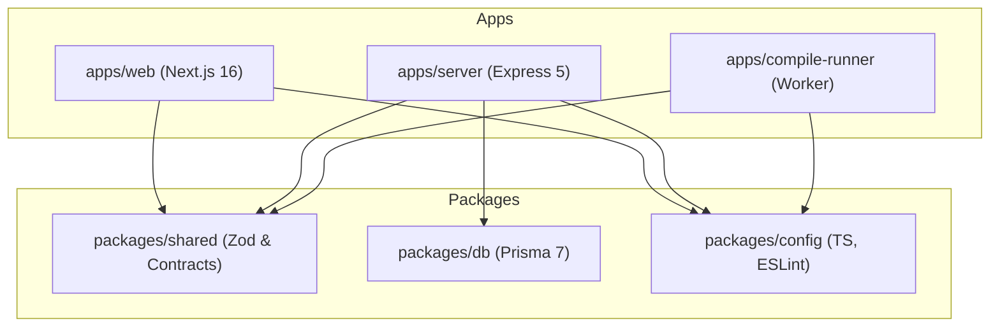

# Phase 00 Completion Report: Monorepo Foundation, Infrastructure & Shared Contracts

**Date:** 2026-11-10  
**Phase:** 00  
**Status:** Completed & Verified  

---

## 1. Executive Summary

Phase 00 established the architectural foundation, development tooling, strict boundaries, and shared domain contracts for Texly as a production-grade TypeScript monorepo.

Key achievements:
- **Turborepo & pnpm Workspaces:** Configured modern monorepo workspaces encompassing `apps/*` (`web`, `server`, `compile-runner`) and `packages/*` (`shared`, `db`, `config`, `latex`, `llm`).
- **Prisma 7 Database Foundation:** Configured PostgreSQL with Prisma ORM, implementing the complete database schema defined in `DATABASE_DESIGN.md`, custom SQL partial unique indexes, and a deterministic database seeding harness.
- **Contract-First Domain Modeling (`packages/shared`):** Zod DTO schemas for all entities (Authentication, Projects, Files, Documents, Compilations, Versions, Proposals), custom error models, response envelopes, pagination schemas, and OpenAPI 3.1 specification generation (`pnpm gen:openapi`).
- **Local Infrastructure (`docker/compose.dev.yml`):** Containerized local development stack with PostgreSQL 17, Redis 7 (no-eviction policy with AOF persistence), MinIO S3-compatible object storage with auto-created buckets, and Mailpit SMTP testing server.
- **Strict Quality & Boundary Enforcement:** TypeScript strict mode, ESLint 9 flat configs, Prettier, dependency-cruiser boundary rules preventing forbidden cross-boundary imports (e.g. `compile-runner` accessing `packages/db` directly), Husky Git hooks, and GitHub Actions CI pipelines.

---

## 2. Monorepo Structure & Package Boundaries

Boundary constraints enforced by `.dependency-cruiser.cjs`:
- `apps/compile-runner` is strictly prohibited from importing `packages/db` (runs isolated with zero direct database access).
- `packages/shared` has zero internal workspace dependencies (pure library).
- Shared contracts are frozen and validated via automated Vitest contract tests.

---

## 3. Database Architecture (`packages/db`)

Defined in `packages/db/prisma/schema.prisma`:
- **Core Entities:** `User`, `Session`, `Workspace`, `WorkspaceMember`, `Project`, `ProjectMember`, `ProjectFile`, `Document`, `DocumentVersion`, `Compilation`, `UploadedAsset`, `AuditLog`.
- **Enums:** `Role` (`OWNER`, `ADMIN`, `EDITOR`, `VIEWER`), `NodeType` (`FILE`, `FOLDER`), `FileKind` (`TEXT`, `ASSET`), `CompilationEngine` (`PDFLATEX`, `XELATEX`, `LUALATEX`), `CompilationStatus` (`QUEUED`, `RUNNING`, `SUCCEEDED`, `FAILED`, `CANCELLED`).
- **Partial Unique Indexes:** Enforced via raw SQL migrations for live paths (`deleted_at IS NULL`), preventing path collisions without blocking soft-delete history.

---

## 4. Verification & Validation

- `pnpm check:boundaries`: Verified zero architectural boundary violations.
- `pnpm gen:openapi`: Successfully outputs compliant OpenAPI 3.1 schema (`docs/openapi.json`).
- `docker compose -f docker/compose.dev.yml up -d`: Boots clean database, cache, storage, and mail instances with automated health checks.
- Contract test suite: All Zod schemas verified against round-trip serialization and deserialization.

