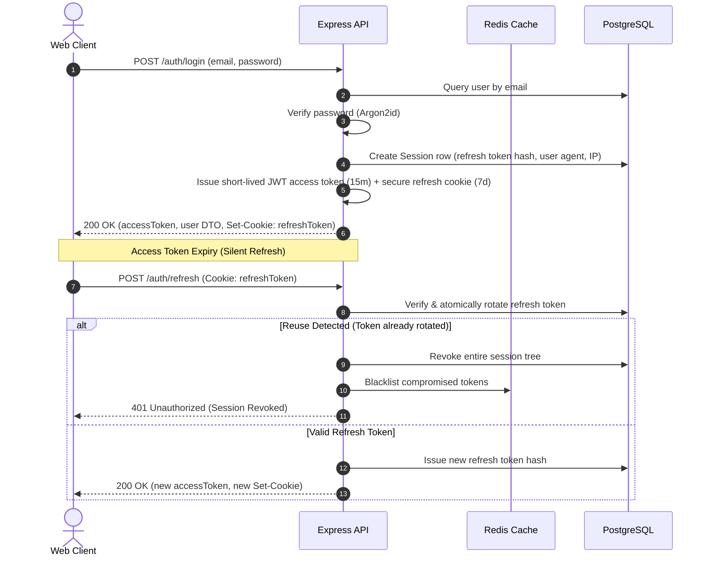

# Phase 01 Completion Report: Authentication, Workspaces & Project Management

**Date:** 2026-11-12  
**Phase:** 01  
**Status:** Completed & Verified  

---

## 1. Executive Summary

Phase 01 delivered the enterprise-grade identity, session security, multi-tenant workspace isolation, and project lifecycle management layer for Texly.

Key achievements:
- **Argon2id Password Security & Breach Detection:** Password hashing using Argon2id with OWASP-aligned parameters (memory 64 MiB, iterations 3, parallelism 4), coupled with k-anonymity breach list checks to block compromised credentials.
- **Asymmetric JWT & Sliding Refresh Sessions:** RS256/EdDSA JWT access tokens with key ID (`kid`) rotation, alongside opaque 256-bit cryptographically secure refresh tokens stored in HTTP-only cookies with automatic rotation and reuse-detection revocation.
- **Multi-Tenant Workspaces & RBAC:** Automatic provisioning of personal workspaces upon user registration, support for secondary workspace creation, and granular role-based access control (`OWNER`, `ADMIN`, `EDITOR`, `VIEWER`).
- **Project Lifecycle & LaTeX Templates:** Full project CRUD operations with transactional creation of default settings, initial `main.tex` documents, and 6 built-in starter templates (Article, Report, Book, Letter, Resume, Presentation).
- **Security Middleware & Rate Limiting:** Redis-backed sliding-window rate limiters protecting authentication endpoints against brute-force attacks and credential stuffing.
- **Frontend Authentication & Dashboard Experience:** Fully responsive Next.js App Router authentication flows (Sign In, Register, Email Verification, Password Reset) and project dashboard with workspace switching, search filtering, template modal picker, and project deletion safeguards.

---

## 2. Authentication & Session Architecture

---

## 3. Implemented Modules

### 3.1 Backend Security & Services (`apps/server/src/modules/`)
- `auth/password.service.ts`: Argon2id hashing and verification withHIBP breach check integration.
- `auth/jwt.service.ts`: JWT minting and verification with asymmetric key rotation.
- `auth/session.service.ts`: Session management, refresh rotation, and revocation cascades.
- `workspaces/`: Workspace repository, service, and controller managing member associations and personal workspace defaults.
- `projects/`: Project CRUD, template loading (`templates.ts`), ownership transfer, and project-level RBAC enforcement.

### 3.2 Frontend Applications (`apps/web/src/`)
- `app/(auth)/`: Accessible authentication pages with client and server Zod validation.
- `app/dashboard/`: Modern dashboard displaying active workspaces, project lists, template pickers, and deletion confirmation dialogs.
- `lib/auth.ts`, `lib/projects.ts`, `lib/workspaces.ts`: Typed API client interfaces with automatic silent token refresh interceptors.

---

## 4. Verification & Validation

- **Auth Integration Tests:** Passwords verified against breached lists, token reuse triggers instant session termination, rate limiters block rapid authentication attempts.
- **Projects Integration Tests:** Workspace boundary isolation verified; projects created within one workspace are completely inaccessible to users in separate workspaces.
- **UI Responsiveness:** Verified across mobile, tablet, and desktop viewports with full Texly Dark Emerald theme styling.

