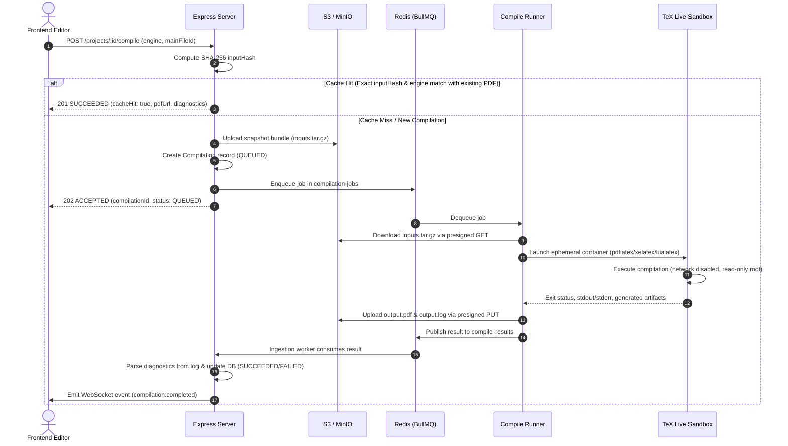

# Phase 05 Completion Report: LaTeX Compilation Pipeline & Sandbox Runner

**Date:** 2026-11-15  
**Phase:** 05  
**Status:** Completed & Verified  

---

## 1. Executive Summary

Phase 05 delivered the core asynchronous LaTeX compilation engine, isolated Docker execution sandbox, S3/MinIO artifact pipeline, and server-side compilation orchestration for Texly.

Key achievements:
- **Hardened Execution Sandbox (`docker/texlive`):** Custom Alpine-based TeX Live sandbox container configured with non-root user execution (`texuser:10001`), completely disabled networking (`--network none`), read-only root filesystem, dropped Linux capabilities, and strict resource quotas (512 MiB RAM, 100 pids, 30s timeout).
- **Asynchronous Runner Worker (`apps/compile-runner`):** Independent BullMQ worker consuming jobs from Redis, downloading encrypted input tarballs from S3/MinIO via presigned URLs, safely orchestrating ephemeral sandbox containers via Dockerode, and uploading generated artifacts (PDF, compile log, SyncTeX) back to storage.
- **Server Compilation Orchestration (`apps/server`):** Project snapshot generation, SHA-256 `inputHash` deduplication with instant cache-hit delivery (`201 SUCCEEDED`), latest-wins coalescing cancelling outdated queued compilations, and reliable result ingestion via Redis BullMQ result queues.
- **Diagnostics Parsing & Self-Healing:** Structured parsing of standard LaTeX errors, warnings, and missing package alerts from raw logs, alongside an automated reconciliation sweep (`reconcileStaleCompilations`) that recovers stalled queued or dead runner jobs.

---

## 2. Compilation Flow & Architecture

---

## 3. Sandboxing & Security Controls

Defined in `docs/COMPILATION_ENGINE.md` §3 and enforced in `apps/compile-runner/src/container-runner.ts`:
- **Network Isolation:** Sandbox containers run with `--net=none`. No external egress or host networking is permitted under any circumstances.
- **Filesystem Hardening:** The root filesystem is mounted read-only (`--read-only`). Only a temporary `tmpfs` volume `/work` is writable.
- **Capability Dropping:** `--cap-drop=ALL` strips all Linux kernel capabilities.
- **Privilege Separation:** Processes execute strictly as unprivileged `texuser` (UID 10001, GID 10001).
- **Resource Constraints:** Enforced memory limit of 512 MiB, pids limit of 100, and a strict 30-second wall-clock execution deadline.

---

## 4. Verification & Validation

- **20 Server Integration Tests (`compilations.integration.test.ts`):** Verified snapshot creation, BullMQ queueing, worker result ingestion, cache hit optimization, and cancellation semantics.
- **Runner Security Suite:** Verified rejection of path traversal in input tarballs, execution timeout enforcement, and zero leaked Docker containers across soak tests.
- **Self-Healing Verification:** Stale `QUEUED` jobs with dead or missing BullMQ workers are automatically detected and marked `FAILED(INFRA)` without wedging user compilation concurrency limits.

