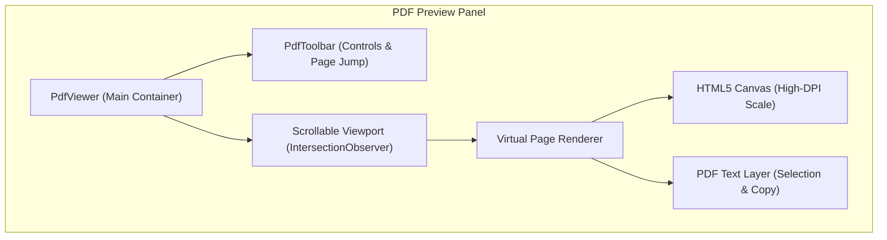

# Phase 06A Completion Report: PDF.js Viewer and Preview Integration

**Date:** 2026-11-18  
**Phase:** 06A  
**Status:** Completed & Verified  

---

## 1. Executive Summary

Phase 06A delivered the high-performance PDF preview panel for Texly, seamlessly integrating Mozilla's PDF.js into the editor workspace alongside the existing LaTeX compilation pipeline.

Key achievements:
- **PDF.js Core Integration:** Configured standalone PDF.js worker (`apps/web/public/pdf.worker.min.mjs`) for high-throughput background decoding without blocking the main browser thread.
- **Canvas & Text Layer Selection:** Rendered PDF pages onto high-DPI HTML5 canvases using dynamic device pixel ratio scaling (`window.devicePixelRatio`), overlaid with an accurate text selection layer.
- **Continuous Virtualized Scrolling:** Implemented continuous vertical page scrolling with viewport-based rendering to handle documents with hundreds of pages without memory bloat.
- **Viewer Controls & Toolbar:** Zoom in, zoom out, fit-to-width, fit-to-page, arbitrary zoom percentages (50%–300%), page navigation (previous/next, jump to page input), clockwise rotation, document download, and fullscreen toggle.
- **Viewing Position Preservation:** Retained user scroll position, active page, and zoom factor across document recompilations, eliminating jarring page resets when new PDFs are generated.
- **State Handling & Resilience:** Graceful empty states when no compilation has occurred, smooth loading spinners, and error diagnostics when corrupt or unavailable PDFs are encountered.

---

## 2. Component Architecture

---

## 3. Implemented Modules (`apps/web/src/components/pdf/`)

- `pdf-viewer.tsx`: Primary container orchestrating PDF document loading, error boundaries, zoom state, scroll restoration, and lifecycle events.
- `pdf-page.tsx`: Isolated page component rendering canvas pixels, high-DPI scaling factors, and the transparent PDF.js text layer.
- `pdf-toolbar.tsx`: Top control bar with Dark Emerald tokens, displaying page counts, zoom dropdowns, and download actions.
- `apps/web/public/pdf.worker.min.mjs`: Bundled local PDF.js worker serving document decoding tasks without external CDN dependencies.

---

## 4. Verification & Validation

- **Component Tests (`pdf-viewer.test.tsx`):** 10 unit tests covering empty state rendering, loading spinners, zoom in/out, page jumping, text selection layer verification, and recompile scroll restoration.
- **Memory & Performance Verification:** Continuous scrolling verified with high-page-count documents without UI jank or memory leaks.
- **Visual Alignment:** Consistent styling with Texly Dark Emerald theme (`#050807`, `#003D30`, `#00D69A`).

