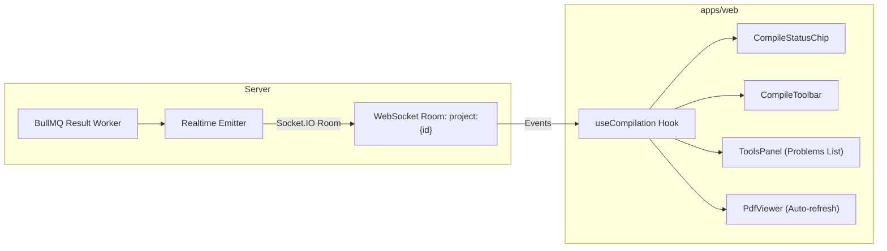

# Phase 06B Completion Report: Realtime Compilation Status and Diagnostics

**Date:** 2026-11-19  
**Phase:** 06B  
**Status:** Completed & Verified  

---

## 1. Executive Summary

Phase 06B delivered the interactive realtime compilation layer for Texly, connecting the frontend editor interface directly with the compilation pipeline and diagnostics engine.

Key achievements:
- **WebSocket Compilation Lifecycle Events:** Socket.IO integration emitting typed compilation lifecycle updates (`compilation:queued`, `compilation:started`, `compilation:completed`, `compilation:failed`, `compilation:cancelled`) to project rooms.
- **Interactive Compile Toolbar:** Responsive compilation toolbar featuring the primary Compile action (`Cmd/Ctrl + Enter`), LaTeX engine selector (`pdfLaTeX`, `XeLaTeX`, `LuaLaTeX`), auto-compile toggle, and dynamic status chip.
- **Dynamic Compilation Status Chip:** Realtime visual feedback with animated spinners and state badges (`IDLE`, `QUEUED`, `RUNNING`, `SUCCEEDED`, `FAILED`, `TIMED_OUT`, `CANCELLED`).
- **Structured Diagnostics & Problems Panel:** Live display of categorized LaTeX compilation issues (Errors, Warnings, Missing Packages), extracted line and column numbers, file context, and single-click jump-to-editor line navigation.
- **Compilation Log Viewer:** Accessible modal viewer providing search, copy-to-clipboard, and download capabilities for full raw LaTeX engine logs.
- **Auto-Compile on Save:** Intelligent debounced compilation trigger reacting to document autosaves when auto-compile mode is enabled.

---

## 2. Realtime Event Architecture

---

## 3. Implemented Components

### 3.1 Editor Compilation Controls (`apps/web/src/components/editor/`)
- `compile-toolbar.tsx`: Top workspace toolbar housing the Compile button, keyboard shortcut handler (`Cmd/Ctrl+Enter`), engine dropdown, auto-compile toggle, and compilation logs button.
- `compile-status-chip.tsx`: Animated visual indicator displaying active compilation states and duration timers.
- `compilation-log-modal.tsx`: Modal dialog displaying raw engine logs with syntax highlighting and export options.
- `tools-panel.tsx`: Bottom collapsible drawer presenting parsed LaTeX problems and warnings with line jump navigation.

### 3.2 Realtime Hooks (`apps/web/src/hooks/`)
- `use-compilation.ts`: Orchestrates TanStack Query mutation for starting compilations with realtime Socket.IO listener updating client state without polling.
- `use-auto-compile.ts`: Monitors document dirty and save states, triggering debounced recompilation after successful saves.

---

## 4. Verification & Validation

- **Component Tests (`compile-toolbar.test.tsx`, `tools-panel.test.tsx`):** Verified button disabled states during active compilations, engine switching, keyboard shortcuts, and problems list line jumping.
- **Realtime Integration:** Validated WebSocket event dispatch and immediate frontend status transitions across all 7 lifecycle states without polling.
- **Log Parsing Accuracy:** Golden document log fixtures verified against diagnostics parser to ensure zero false-positive error reporting.

