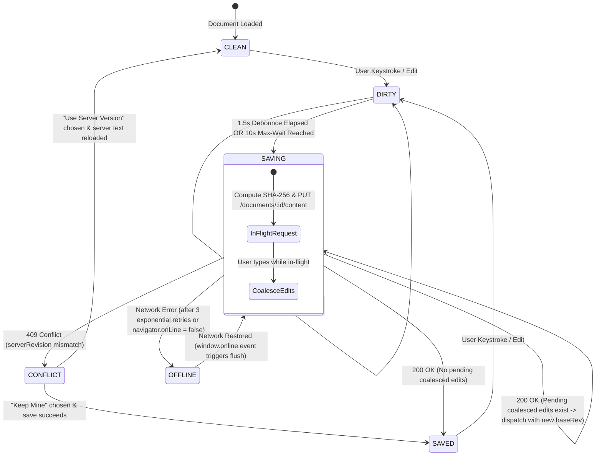

# Phase 07B Completion Report: Frontend Autosave, Draft Recovery & Conflict Resolution

**Date:** 2026-11-20  
**Phase:** 07B  
**Status:** Completed & Verified  

---

## 1. Executive Summary

Phase 07B delivers a robust, deterministic frontend document autosaving, local crash recovery, revision conflict resolution, and realtime synchronization architecture for Texly.

Integrating with the backend revision control, optimistic concurrency locking, and Socket.IO infrastructure established in Phase 07A, Phase 07B guarantees end-to-end data integrity:
- **Zero Silent Data Loss:** Users can never lose uncommitted keystrokes due to tab crashes, browser reloads, or transient network outages.
- **Zero Silent Overwrites:** Concurrent edits across browser tabs or collaborating users are strictly detected; concurrent modifications trigger dedicated conflict reconciliation rather than silently clobbering remote changes.
- **REST-Driven Persistence:** All state-changing mutations remain strictly REST-based (`PUT /api/v1/projects/:projectId/documents/:documentId/content`), keeping the backend authoritative.

Key architectural deliverables:
1. **Deterministic Autosave State Machine:** Formalized state lifecycle (`CLEAN` → `DIRTY` → `SAVING` → `SAVED` / `CONFLICT` / `OFFLINE`) with 1.5s debounce, 10s max-wait interval guarantees, in-flight coalesced queuing, and exponential backoff retry.
2. **IndexedDB Local Crash Recovery:** Persistent client-side draft store (`texly_editor_db` with `drafts` object store) recording active drafts on every edit, with automatic detection and prompt restoration upon subsequent session initialization.
3. **Dedicated Conflict Resolution Modal:** Visual side-by-side comparison offering deterministic reconciliation paths: "Use Server Version" and "Keep Mine (Overwrite Server)".
4. **Draft Recovery Banner:** Non-intrusive notification surfacing uncommitted local crash drafts with single-click restoration or discard.
5. **Realtime Socket.IO Reconciliation:** Workspace-level subscription to `project:${projectId}` and active `document:${documentId}` rooms, handling remote revision events, file tree updates, and reconnect sync.
6. **Dark Emerald Design Language:** Status chips and dialogs fully styled using `#050807` background, `#003D30` borders/accents, and `#00D69A` highlights.

---

## 2. Autosave State Machine Architecture



### State Definitions & Transitions

| State | Indicator | Description | Trigger / Guard |
| :--- | :--- | :--- | :--- |
| **`CLEAN`** | Idle / Subtle Rev tag | Document content matches server content exactly. No unsaved changes. | Document loaded or conflict resolved via server version. |
| **`DIRTY`** | Amber pulsing dot `Unsaved changes` | Document modified locally. Local draft immediately mirrored to IndexedDB. | Any user keystroke differing from `lastSavedContent`. |
| **`SAVING`** | Emerald spinner `Saving...` | Network PUT request actively in-flight. Concurrency guarded to 1 request. | 1.5s debounce expires OR 10s max-wait window reached. |
| **`SAVED`** | Emerald checkmark `Saved` | Server confirmed 200 OK and no new keystrokes occurred during save. IndexedDB draft cleared. | Successful PUT response with updated revision. |
| **`CONFLICT`** | Rose alert `Conflict detected` | Server returned 409 `REVISION_CONFLICT`. Local draft preserved in IndexedDB. | Concurrent save detected; baseRevision outdated. |
| **`OFFLINE`** | Amber/rose `Offline (Draft saved)` | Network unavailable or retries exhausted. Keystrokes safely preserved in IndexedDB. | `navigator.onLine === false` or 3 failed network retries. |

---

## 3. Concurrency Guarantees & Coalescing Invariants

### 1. In-Flight Request Locking & Coalescing
At no point can two HTTP save requests be in-flight simultaneously for the same document.
- When `isSavingRef === true`, new user keystrokes do not spawn new requests; instead, `pendingContentRef` captures the latest buffer.
- When the active request returns `200 OK` with revision `R`:
  - If `pendingContentRef !== null` and differs from `lastSavedContent`, a follow-up request is immediately dispatched using `baseRevision = R`.
  - The status remains `SAVING` until the queue empties.
  - The state transitions to `SAVED` only when the server has confirmed content matching the user's latest buffer.

### 2. Debounce and 10-Second Max-Wait
- **1.5s Debounce:** Pauses in typing automatically trigger save within 1500ms.
- **10s Max-Wait Window:** If a user types continuously without taking a 1.5s pause, an interval timer guarantees that a save request is dispatched no later than 10 seconds from the initial dirty keystroke, bounding uncommitted drift.

### 3. Exponential Backoff on Transient Network Errors
- If a save request fails due to a network glitch or server 5xx:
  - Retry 1: 1000ms delay.
  - Retry 2: 2000ms delay.
  - Retry 3: 4000ms delay.
- If all 3 retries fail or `navigator.onLine === false`, the hook transitions to `OFFLINE`.
- When the browser fires the `window.online` event, the queue automatically re-initiates an immediate flush save.

---

## 4. Local Crash Recovery via IndexedDB

IndexedDB storage operates completely offline and independent of network availability:

- **Database:** `texly_editor_db` (Version 1)
- **Object Store:** `drafts` (KeyPath: `documentId`)
- **Index:** `by_project` on `projectId`
- **Record Schema:**
  ```typescript
  export interface DocumentDraft {
    documentId: string;
    projectId: string;
    content: string;
    baseRevision: number;
    baseHash: string;
    updatedAt: string; // ISO 8601
  }
  ```

### Lifecycle & Crash Restoration
1. **Immediate Write on Dirty:** Whenever the editor buffer changes, `saveDraft(...)` writes the draft to IndexedDB asynchronously.
2. **Reconciliation on Save:** Once the server responds `200 OK`, `deleteDraft(documentId)` cleans up the IndexedDB record.
3. **Crash Recovery Detection:** When a document is mounted, the hook checks IndexedDB:
   - If a draft exists and its `updatedAt` is newer than or differs from the authoritative server document, it is marked as an unrecovered draft.
   - The UI displays the `DraftRecoveryBanner` offering:
     - **"Restore Draft":** Injects the recovered text into the editor, marks status `DIRTY`, and resumes normal autosave.
     - **"Discard":** Clears the IndexedDB record and keeps the authoritative server document.

---

## 5. Conflict Resolution Workflow & Modal

When a concurrent edit is rejected by the server with `409 REVISION_CONFLICT`:
1. The hook transitions to `CONFLICT`.
2. The local text is strictly preserved in the editor and IndexedDB.
3. The hook fetches the latest server document to retrieve `serverContent`, `serverRevision`, and `serverUpdatedAt`.
4. The `ConflictModal` opens, presenting:
   - **Side-by-Side View:** Visual comparison of "Your Draft (Local)" vs "Server Version (Revision X)".
   - **Dedicated Tabs:** Option to inspect "Your Local Changes" or "Authoritative Server Content" individually.
   - **Resolution Option A: "Use Server Version":**
     - Clears the local draft from IndexedDB.
     - Overwrites editor with server content.
     - Aligns local `baseRevision` with `serverRevision`.
     - Transitions status to `CLEAN`.
   - **Resolution Option B: "Keep Mine (Overwrite Server)":**
     - Adopts latest `serverRevision` as new `baseRevision`.
     - Dispatches immediate save with local content and updated `baseRevision`.
     - On 200 OK, advances to `SAVED` and closes modal.
   - **Resolution Option C: "Close":**
     - Leaves local editor content intact so the user can review or copy snippets manually.

---

## 6. Realtime Socket.IO Integration

Implemented in `apps/web/src/hooks/use-realtime-sync.ts` and `apps/web/src/lib/socket-client.ts`:
- **Room Management:**
  - On workspace load, joins `project:${projectId}`.
  - On active document selection, joins `document:${documentId}`; leaves previous document room on tab switch.
- **`document.revision.changed` Handling:**
  - If the active document is in a `CLEAN` / `SAVED` state: silently reloads the document so the editor remains fresh with the latest remote revision.
  - If the active document is in a `DIRTY` / `SAVING` state: user edits are **never** overwritten; a background conflict warning is logged/flagged.
- **`file.tree.changed` Handling:**
  - Invalidates TanStack Query key `['project-files', projectId]`, updating the File Explorer tree immediately.
- **Reconnection Synchronization:**
  - When the socket reconnects after a drop, it emits `project.sync` to reconcile missed file mutations and compilation states.

---

## 7. UI / UX Design & Dark Emerald Integration

All components adhere to Texly's Dark Emerald design system tokens:
- **Backgrounds:** Canvas `#050807`, Panes `#070e0b` / `#0A1310`, Subheaders `#0A120E`.
- **Borders & Dividers:** Subtle emerald `#003D30` and `#003D30]/60`.
- **Accent & Highlights:** Emerald `#00D69A` for saved states, recovery badges, and primary actions.
- **Warning & Conflict:** Amber `#f59e0b` for unsaved/offline, Rose `#f43f5e` for revision conflicts.

---

## 8. Test Matrix & Verification Results

### Unit, Component & Integration Test Suites

| Suite | Target | Tests | Status |
| :--- | :--- | :---: | :---: |
| `draft-storage.test.ts` | IndexedDB local draft CRUD, project filtering, multi-draft isolation | 5 | **PASS** |
| `use-document-autosave.test.tsx` | State machine, 1.5s debounce, 10s max-wait, coalesced save queue, 409 conflict, crash recovery detection | 7 | **PASS** |
| `conflict-modal.test.tsx` | Modal rendering, side-by-side / tabbed diff view, Use Server action, Keep Mine action, close | 7 | **PASS** |
| `draft-recovery-banner.test.tsx` | Prompt rendering, date/revision display, restore click, discard click | 4 | **PASS** |
| `autosave-conflict.integration.test.tsx` | End-to-end multi-tab simulation: concurrent edit → 409 conflict → modal display → Keep Mine / Use Server resolution | 2 | **PASS** |

### Complete Monorepo Verification Summary

- **`@texly/web` Unit & Integration Tests:** 25 files passed, **133 passed** (0 failed).
- **`@texly/server` Unit & Integration Tests:** 10 files passed, **107 passed** (0 failed).
- **Total Monorepo Tests:** **240 passed**, 0 failed.
- **TypeScript Static Analysis:** 0 errors across `@texly/web`, `@texly/server`, and `@texly/shared`.
- **Architecture & Boundaries (`depcruise`):** 999 modules, 2030 dependencies cruised, **0 violations**.

---

## 9. Deliverables Inventory

| File Path | Description |
| :--- | :--- |
| `apps/web/src/lib/draft-storage.ts` | IndexedDB storage service for document drafts with SSR and error isolation. |
| `apps/web/src/hooks/use-document-autosave.ts` | Complete autosave state machine hook (CLEAN, DIRTY, SAVING, SAVED, CONFLICT, OFFLINE), debouncing, max wait, coalescing, retry. |
| `apps/web/src/hooks/use-realtime-sync.ts` | Socket.IO room manager & realtime event coordinator (revisions, file trees, reconnect sync). |
| `apps/web/src/stores/editor.store.ts` | Extended Zustand editor store with per-document save status, conflict state, and unrecovered drafts. |
| `apps/web/src/lib/socket-client.ts` | Upgraded Socket.IO manager with document rooms, typed events, and `project.sync` support. |
| `apps/web/src/components/editor/conflict-modal.tsx` | Visual revision conflict comparison dialog with "Use Server" and "Keep Mine" actions. |
| `apps/web/src/components/editor/draft-recovery-banner.tsx` | Editor banner for recovering uncommitted drafts from previous sessions or crashes. |
| `apps/web/src/components/editor/save-status-indicator.tsx` | Enhanced status chip with Dark Emerald styling for all 6 save states. |
| `apps/web/src/app/workspace/page.tsx` | Integrated workspace wiring autosave, crash recovery banner, conflict modal, and realtime sync. |
| `apps/web/src/__tests__/lib/draft-storage.test.ts` | Tests for IndexedDB draft storage engine. |
| `apps/web/src/__tests__/hooks/use-document-autosave.test.tsx` | Tests for autosave state transitions, debouncing, max-wait, and coalesced saves. |
| `apps/web/src/__tests__/components/conflict-modal.test.tsx` | Tests for conflict modal rendering and actions. |
| `apps/web/src/__tests__/components/draft-recovery-banner.test.tsx` | Tests for draft recovery banner interactions. |
| `apps/web/src/__tests__/integration/autosave-conflict.integration.test.tsx` | Integration test for concurrent two-tab editing and conflict resolution. |

